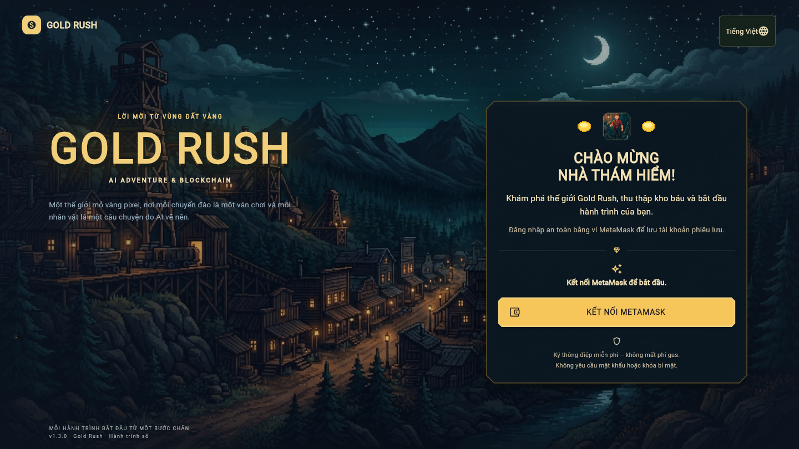
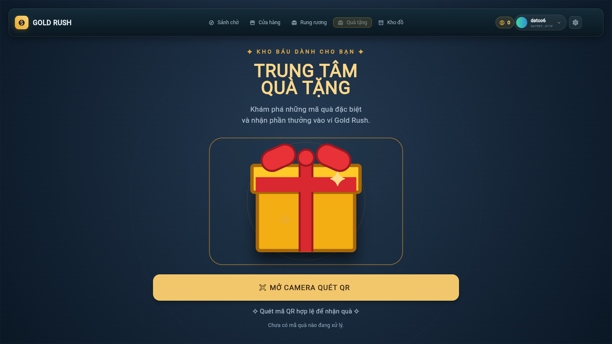

# Gold Rush Blockchain

> Trò chơi phiêu lưu 2D kết hợp blockchain, ví Web3, NFT, SBT, phần thưởng QR và mô-đun AI.

Gold Rush là đồ án game Web3 chạy trên Flutter/Flame. Người chơi khám phá bản đồ thế giới, hoàn thành các màn chơi, nhận vàng, sử dụng vật phẩm NFT, nhận huy hiệu thành tích SBT và đổi phần thưởng bằng mã QR.

## Demo và dịch vụ

| Thành phần | Địa chỉ / thông tin |
|---|---|
| Web game | [gold-rush-web.web.app](https://gold-rush-web.web.app) |
| Backend API | [gold-rush-api.onrender.com](https://gold-rush-api.onrender.com) |
| Trang quản trị QR | [gold-rush-web.web.app/admin](https://gold-rush-web.web.app/admin) |
| Mạng blockchain kiểm thử | Sepolia, chain ID `11155111` |
| Blockchain local | Hardhat, chain ID `31337` |
| Mã nguồn | [github.com/datco06/gold_rush_nft](https://github.com/datco06/gold_rush_nft) |

> Các dịch vụ demo phụ thuộc vào trạng thái deploy, database và cấu hình môi trường hiện tại. Không dùng tài khoản, private key hoặc dữ liệu thật trong môi trường demo.

## Chức năng chính

- Đăng nhập bằng ví Web3 và xác thực phiên với backend.
- Bản đồ thế giới gồm nhiều màn chơi, mở khóa theo tiến trình.
- Gameplay 2D bằng Flutter Flame: di chuyển, chiến đấu, thu thập vàng và hoàn thành màn.
- Sinh quái theo màn và điều chỉnh nhịp độ để phù hợp trải nghiệm chơi.
- Lưu tiến trình, vàng, nhiệm vụ và kết quả ván chơi trên backend.
- Cửa hàng vật phẩm và kho đồ NFT ERC-1155.
- Đồng bộ số lượng NFT bằng `balanceOfBatch`, hiển thị trạng thái tải khi dữ liệu blockchain chưa sẵn sàng.
- Cấp huy hiệu thành tích dưới dạng SBT ERC-721 có chữ ký EIP-712.
- Faucet Sepolia cho ví thiếu ETH để thực hiện giao dịch ký ví.
- Trung tâm quà tặng: quét mã QR để nhận vàng, giày, giáp hoặc vũ khí.
- Mô-đun AI phục vụ phân tích, sinh dữ liệu và các API hỗ trợ đồ án.
- CI/CD bằng GitHub Actions, Firebase Hosting và Render.

> Tính năng tạo nhân vật bằng AI hiện đang ẩn trong bản build demo. Các test
> trực tiếp cho màn hình Xưởng AI được đánh dấu skip có lý do; các test model,
> schema và API AI độc lập vẫn được giữ lại để kiểm tra contract dữ liệu.

## Hình ảnh giao diện

**Bản đồ thế giới** · Khám phá Làng khởi đầu và chọn màn chơi.


| Màn hình đăng nhập | Trung tâm quà tặng |
|---|---|
|  |  |

## Kiến trúc tổng quan

```text
+-------------------+       HTTPS        +-----------------------+
| Flutter Web / APK | -----------------> | FastAPI Backend       |
| Flutter + Flame   |                    | Auth, game, rewards   |
+---------+---------+                    +-----------+-----------+
          |                                          |
          | WalletConnect / MetaMask                 | SQLite/PostgreSQL
          v                                          v
+-------------------+                    +-----------------------+
| Ví người chơi     |                    | Database              |
| Sepolia           |                    | User, game, QR codes |
+---------+---------+                    +-----------------------+
          |
          | RPC / signed transaction
          v
+----------------------------------------------------+
| Smart contracts: Store, NFT ERC-1155, SBT         |
| Sepolia / Hardhat local                            |
+----------------------------------------------------+
```

## Cấu trúc thư mục

```text
Gold_Rush_Blockchain_v1.3_2026/
├── gold_rush/                 # Ứng dụng Flutter, Flame và giao diện Web3
├── gold_rush_admin/           # Giao diện Web quản trị mã QR quà tặng
├── gold_rush_ai/              # FastAPI backend, AI, database và QR rewards
├── gold_rush_chain/           # Smart contracts Hardhat
├── docs/                      # Tài liệu tích hợp NFT và SBT
├── .github/workflows/         # CI, deploy Firebase và build APK
└── README.md                  # Tài liệu tổng quan dự án
```

Tài liệu chi tiết theo từng phần:

- [Flutter game](gold_rush/README.md)
- [Giao diện quản trị QR](gold_rush_admin/index.html)
- [Backend và AI](gold_rush_ai/README.md)
- [Smart contracts](gold_rush_chain/README.md)
- [Tích hợp NFT](docs/NFT_INTEGRATION.md)
- [Tích hợp SBT](docs/SBT_INTEGRATION.md)

## Công nghệ sử dụng

- **Frontend game:** Flutter, Dart, Flame, Reown AppKit/WalletConnect.
- **Frontend admin:** HTML, CSS và JavaScript thuần; API được phục vụ bởi FastAPI.
- **Backend:** Python 3.12, FastAPI, SQLAlchemy, Alembic, SQLite/PostgreSQL.
- **Blockchain:** Solidity, Hardhat, OpenZeppelin, EIP-712, Sepolia.
- **AI/data:** Python, mô-đun AI nội bộ và dữ liệu gameplay.
- **Triển khai:** GitHub Actions, Firebase Hosting, Render.

### AI hỗ trợ phát triển

Dự án sử dụng nhiều công cụ AI theo mức độ phức tạp của công việc. AI chỉ hỗ
trợ phát triển.

#### Phân chia công việc AI

| Công cụ | Nhóm công việc | Ví dụ trong dự án |
|---|---|---|
| **Google Gemini** | Công việc đơn giản, yêu cầu rõ ràng và ít ảnh hưởng hệ thống | Viết API CRUD cơ bản, tạo schema, dữ liệu mẫu, tài liệu endpoint và thông báo lỗi |
| **OpenAI GPT/Codex** | Công việc phức tạp, cần đọc nhiều file, phân tích nguyên nhân và đánh giá bảo mật | Điều tra lỗi gameplay, xử lý xác thực SIWE, phiên đăng nhập, CSRF/CORS, tích hợp blockchain, sửa race condition và refactor nhiều mô-đun |

## Yêu cầu môi trường

- Flutter stable và Dart SDK tương ứng.
- Android SDK Platform 37, Build Tools, Platform Tools và JDK 21 nếu build APK.
- Python 3.12 trở lên.
- Node.js 20+ và npm.
- Git.
- MetaMask hoặc ví Web3 tương thích.
- Sepolia ETH chỉ cần khi chạy các giao dịch on-chain bằng ví người chơi hoặc deploy contract.

## Chạy local

### 1. Smart contracts local

```bash
cd gold_rush_chain
npm ci
npx hardhat compile
npx hardhat test
npx hardhat node
```

Nếu chạy backend/frontend với Hardhat local, dùng chain ID `31337` và RPC mặc định `http://127.0.0.1:8545`.

### 2. Backend FastAPI

```bash
cd gold_rush_ai
python3 -m venv .venv
source .venv/bin/activate
python -m pip install --upgrade pip
pip install -r requirements.txt
cp .env.example .env
python -m uvicorn api.main:app --host 0.0.0.0 --port 8000
```

Các biến môi trường quan trọng được khai báo trong `gold_rush_ai/.env.example`, gồm:

- URL/RPC blockchain và chain ID.
- Địa chỉ các contract cửa hàng, NFT và SBT.
- Cấu hình faucet Sepolia.
- Khóa ký backend cho các luồng đã được ủy quyền.
- Cấu hình database và secret xác thực.

### 3. Flutter Web

```bash
cd gold_rush
flutter pub get
flutter run -d chrome \
  --web-port 5174 \
  --dart-define=GOLD_RUSH_API=http://127.0.0.1:8000
```

Nếu không truyền `GOLD_RUSH_API`, ứng dụng có thể dùng giá trị mặc định trong mã nguồn. Khi test local nên truyền rõ URL backend để tránh gọi nhầm API production.

### 4. Flutter Android

Có thể chạy trên máy ảo Android SDK để thử giao diện và luồng mở MetaMask.
Xem [cấu hình máy ảo và cách chạy Android](gold_rush/README.md#23-chạy-bản-android).
Để dùng chung API demo và Sepolia với người kiểm thử, dùng cùng bộ cấu hình
trong mục [Đóng gói APK thủ công](#đóng-gói-apk-thủ-công).

## Cấu hình blockchain

Hai mạng được sử dụng trong đồ án:

| Mạng | Chain ID | Mục đích |
|---|---:|---|
| Hardhat local | `31337` | Phát triển và kiểm thử contract |
| Sepolia | `11155111` | Demo giao dịch và ký ví |

Các địa chỉ contract phải được cấu hình theo lần deploy tương ứng. Không lấy địa chỉ contract của mạng khác để dùng trên Sepolia.

Ví dụ nhóm biến môi trường:

```dotenv
CHAIN_ID=11155111
BLOCKCHAIN_RPC_URL=https://sepolia.infura.io/v3/<PROJECT_ID>
HOP_DONG_CUA_HANG=0x...
HOP_DONG_VAT_PHAM=0x...
HOP_DONG_SBT=0x...
SBT_ENABLED=true
SBT_CHAIN_ID=11155111
SBT_AUTHORIZED_SIGNER=0x...
```

Private key chỉ được đặt trong `.env` local hoặc secret của Render/GitHub. Không commit private key, seed phrase, token API hoặc thông tin đăng nhập vào Git.

## Faucet Sepolia

Backend có thể cấp ETH test cho ví người chơi thiếu phí gas. Luồng tổng quát:

1. Backend kiểm tra số dư ví trên Sepolia.
2. Nếu thiếu ETH, backend gửi giao dịch faucet từ ví cấp phát.
3. Backend trả trạng thái giao dịch để frontend tiếp tục theo dõi.
4. Frontend kiểm tra lại số dư trước khi yêu cầu người chơi ký giao dịch.

Faucet chỉ dùng cho Sepolia/testnet. Cần cấu hình đúng RPC, địa chỉ ví faucet và private key tương ứng trong môi trường Render. Private key của faucet không phải địa chỉ ví; địa chỉ là public address, còn private key là chuỗi bí mật của chính ví đó.

## Huy hiệu SBT

Luồng SBT sử dụng contract thành tích riêng và chữ ký EIP-712:

- `HOP_DONG_SBT`: địa chỉ contract ThanhTuuSBT trên đúng mạng.
- `SBT_AUTHORIZED_SIGNER`: địa chỉ public tương ứng với private key ký backend.
- `SBT_SIGNER_PRIVATE_KEY`: private key của signer được contract ủy quyền.
- `SBT_VOUCHER_TTL_SECONDS`: thời hạn voucher, ví dụ `900` giây.

Không dùng private key ví người chơi để làm signer backend nếu không thật sự cần thiết. Sau khi thay đổi biến môi trường trên Render, cần lưu/redeploy service rồi kiểm tra log và transaction trên Sepolia explorer.

## Mã QR quà tặng

Mã QR quà tặng được tạo và quản lý bằng trang admin:

- [Trang admin trên Web game](https://gold-rush-web.web.app/admin)
- [Trang admin trực tiếp trên Render](https://gold-rush-api.onrender.com/admin)

Đăng nhập bằng tài khoản quản trị được cấu hình trên backend. Không ghi mật
khẩu production, private key hoặc secret vào README và Git.

Quy trình tạo QR:

1. Mở trang admin và đăng nhập.
2. Nhập tên chương trình hoặc tên quà tặng.
3. Chọn phần thưởng là **Vàng** hoặc **Vật phẩm NFT**.
4. Nếu chọn NFT, chọn tên vật phẩm trong danh mục 27 vật phẩm; trang admin tự
   sử dụng đúng Token ID tương ứng.
5. Nhập số lượng, tổng lượt nhận tối đa và hạn sử dụng nếu cần.
6. Chọn **Tạo mã & QR**, sau đó tải ảnh PNG hoặc lưu mã quà tặng ngay.

Mã đầy đủ chỉ hiển thị trong lần tạo. Database chỉ lưu SHA-256 của mã trong
bảng `gift_codes`; QR chỉ chứa mã ngẫu nhiên, không chứa trực tiếp số vàng,
Token ID hoặc số lượng phần thưởng. Backend vẫn là thành phần xác thực mã, giới
hạn lượt nhận và cấp voucher để người chơi nhận thưởng.

Trang admin còn cho phép xem 100 mã mới nhất và khóa hoặc mở lại mã. Mỗi ví
được nhận tối đa một lần cho mỗi mã. Khi tạo quà NFT, Token ID phải thuộc danh
mục đã đăng ký trên hợp đồng vật phẩm.

Không cần sửa `codes.json`, tạo PNG bằng script hoặc push dữ liệu QR lên Git.
Mã được ghi trực tiếp vào database đang dùng bởi backend. Nếu Render sử dụng
SQLite, cần gắn Persistent Disk cho `gold_rush_ai/data`; nếu không, mã tạo từ
admin có thể mất khi service restart hoặc redeploy.

> QR code là dữ liệu có thể đổi lấy phần thưởng. Không công khai mã chưa phát hành và nên thu hồi/đổi mã nếu bị lộ.

## Kiểm thử

### Smart contracts

```bash
cd gold_rush_chain
npx hardhat compile
npx hardhat test
```

### Backend

```bash
cd gold_rush_ai
source .venv/bin/activate
pytest -v
```

Một số test tích hợp cần database, biến môi trường hoặc service tương ứng. Khi kiểm tra nhanh theo pipeline CI, dùng đúng nhóm test được khai báo trong `.github/workflows/ci.yml`.

### Flutter

```bash
cd gold_rush
flutter analyze --no-fatal-infos
flutter test
```

Số lượng test thay đổi theo từng phiên bản. Có thể chạy riêng nhóm xác thực ví
native, blockchain, Quà tặng và chiến đấu từ `gold_rush/` bằng PowerShell:

```powershell
$blockchainTests = Get-ChildItem test/blockchain -Recurse -Filter '*_test.dart' |
  Where-Object { $_.Name -notlike '*_web_test.dart' } |
  ForEach-Object FullName
flutter test test/auth/metamask_siwe_native_test.dart @blockchainTests
flutter test test/man_hinh/trung_tam_qua_tang_test.dart test/chien_dau/ban_sat_mep_test.dart test/chien_dau/ban_ap_sat_test.dart
```

## Kiểm tra nhanh bản Web

Sau khi deploy, kiểm tra lần lượt các luồng chính:

1. Đăng nhập bằng MetaMask và xác nhận đúng mạng Sepolia.
2. Mở Sảnh chờ, Bản đồ thế giới và chọn một màn đã mở khóa.
3. Mở Cửa hàng, kiểm tra danh mục và vật phẩm hiển thị.
4. Mở Kho đồ, kiểm tra số lượng vật phẩm và trạng thái đồng bộ.
5. Mở Trung tâm quà tặng, kiểm tra nút mở QR scanner và quyền camera.
6. Nếu test giao dịch, dùng ví test có Sepolia ETH và chỉ kiểm tra trên testnet.

Không thực hiện mua hàng hoặc claim QR trong smoke test nếu không muốn thay đổi
dữ liệu tài khoản đang dùng.

## CI/CD

Các workflow nằm trong `.github/workflows/`:

| Workflow | Khi chạy | Kết quả |
|---|---|---|
| `ci.yml` | Push/PR vào `main`, `dev` | Compile/test contract, test backend, analyze/test Flutter |
| `deploy-web.yml` | Thay đổi `gold_rush/**` trên `main` | Build Flutter Web và deploy Firebase Hosting nếu có `FIREBASE_TOKEN` |
| `build-apk.yml` | Thay đổi `gold_rush/**` hoặc tag `v*` | Build APK, upload artifact; tag `v*` tạo GitHub Release |

Workflow APK hiện chỉ truyền `GOLD_RUSH_API`. Để gửi bản có luồng kết nối
MetaMask, dùng lệnh đóng gói thủ công với đầy đủ cấu hình Android bên dưới.

Backend Render được cấu hình Auto-Deploy theo branch `main`. Thay đổi mã backend
phải được push lên `main` để Render tạo deploy mới. Mã QR tạo trong trang admin
được ghi trực tiếp vào database nên không cần commit hoặc push Git. Có thể kiểm
tra trạng thái triển khai tại mục **Deploys** của service `gold-rush-api`.

Để GitHub Actions ký APK bằng keystore release, thêm các mục sau vào
**Settings → Secrets and variables → Actions → Repository secrets**.

| Secret | Giá trị |
|---|---|
| `GOLD_RUSH_RELEASE_KEYSTORE_BASE64` | Nội dung tệp keystore được mã hóa Base64 |
| `GOLD_RUSH_RELEASE_STORE_PASSWORD` | Mật khẩu keystore |
| `GOLD_RUSH_RELEASE_KEY_ALIAS` | Tên khóa trong keystore |
| `GOLD_RUSH_RELEASE_KEY_PASSWORD` | Mật khẩu của khóa |

Workflow dùng keystore này cho bản APK khi các secret đã có đủ. Lượt chạy
trên nhánh có thể dùng khóa debug khi chưa có cấu hình ký riêng. Lượt chạy
từ tag `v*` yêu cầu keystore release để phát hành. Tăng số build trong
`gold_rush/pubspec.yaml` trước mỗi lần phát hành bằng workflow để tester
có thể cài cập nhật.

Các secret cần được đặt trong GitHub/Render, không đặt trong workflow hoặc README:

- `FIREBASE_TOKEN` cho Firebase Hosting.
- RPC URL, contract address và các khóa ký cần thiết cho Render.

## Đóng gói APK thủ công

### Build APK test nhanh sau khi clone

Không thể bảo đảm chỉ clone rồi chạy `flutter build apk --release` là thành
công nếu máy chưa có Android SDK hoặc chưa cấu hình chữ ký. Để tạo APK test
bằng khóa debug trên macOS/Linux, chạy:

```bash
git clone https://github.com/datco06/gold_rush_nft.git
cd gold_rush_nft/gold_rush
flutter doctor -v
flutter doctor --android-licenses
flutter pub get
GOLD_RUSH_ALLOW_DEBUG_SIGNING=true \
  flutter build apk --release \
  --dart-define=GOLD_RUSH_API=https://gold-rush-api.onrender.com
```

Trên PowerShell:

```powershell
git clone https://github.com/datco06/gold_rush_nft.git
Set-Location .\gold_rush_nft\gold_rush
flutter doctor -v
flutter doctor --android-licenses
flutter pub get
$env:GOLD_RUSH_ALLOW_DEBUG_SIGNING = 'true'
flutter build apk --release --dart-define=GOLD_RUSH_API=https://gold-rush-api.onrender.com
Remove-Item Env:GOLD_RUSH_ALLOW_DEBUG_SIGNING
```

APK test được tạo tại
`gold_rush/build/app/outputs/flutter-apk/app-release.apk`. Cách này chỉ dùng
để kiểm thử và tạo chữ ký khác APK phát hành chính thức. Kết nối MetaMask có
thể chưa hoạt động đầy đủ nếu thiếu `REOWN_PROJECT_ID` và các cấu hình redirect.

Để tạo bản đầy đủ, tiếp tục cấu hình keystore và file Dart define theo các mục
bên dưới. Không đưa keystore, mật khẩu, private key hoặc seed phrase lên Git.

### Yêu cầu cho bản build đầy đủ

Máy build cần Flutter, Android SDK Platform 37, Build Tools và Platform Tools.
Bản APK test trên Windows được build với Flutter 3.50.1, JDK 21 chạy Gradle,
NDK 28.2.13676358 và CMake 3.22.1. Mã ứng dụng vẫn nhắm Java 17. Dùng
`flutter doctor -v` để kiểm tra JDK và SDK Flutter đang dùng.

### Cấu hình keystore release

Tạo keystore một lần bằng `keytool` của JDK. Lệnh PowerShell sau đặt keystore
ngoài thư mục dự án. Nếu đã có keystore của Gold Rush, dùng lại tệp đó.

```powershell
$keystore = Join-Path $env:USERPROFILE 'gold-rush-release.jks'
& "$env:JAVA_HOME\bin\keytool.exe" -genkeypair -v -keystore $keystore `
  -storetype JKS -alias goldrush-release -keyalg RSA -keysize 2048 -validity 10000
```

Tạo `gold_rush/android/key.properties` theo mẫu sau. Thay các giá trị mẫu
bằng thông tin đã nhập lúc tạo khóa. Có thể dùng dấu `/` trong đường dẫn
Windows. Nếu dùng đường dẫn tương đối, Gradle tính từ `gold_rush/android/`.

```properties
storeFile=C:/Users/your-user/gold-rush-release.jks
storePassword=<mat-khau-keystore>
keyAlias=goldrush-release
keyPassword=<mat-khau-khoa>
```

Gradle tự ký khi chạy `flutter build apk --release`. Giữ bản sao keystore
và mật khẩu ở nơi an toàn. Git bỏ qua `key.properties` và tệp `.jks` trong
thư mục Android. [Hướng dẫn ký ứng dụng của Flutter](https://docs.flutter.dev/deployment/android#sign-the-app)

### Build và kiểm tra APK

Từ thư mục gốc, lưu cấu hình dưới đây vào
`build/gold-rush-android-defines.json` và thay `<project-id>` bằng Project ID
của Gold Rush trên Reown. Thư mục `build/` được Git bỏ qua.

```json
{
  "GOLD_RUSH_API": "https://gold-rush-api.onrender.com",
  "REOWN_PROJECT_ID": "<project-id>",
  "GOLD_RUSH_DAPP_URL": "https://gold-rush-web.web.app",
  "GOLD_RUSH_NATIVE_ORIGIN": "https://gold-rush-web.web.app",
  "GOLD_RUSH_NATIVE_REDIRECT": "goldrush://",
  "GOLD_RUSH_APP_LINK": "https://gold-rush-web.web.app/wc",
  "GOLD_RUSH_SEPOLIA_RPC_URL": "https://ethereum-sepolia-rpc.publicnode.com"
}
```

Backend phải cho phép giá trị `GOLD_RUSH_NATIVE_ORIGIN` và trả cấu hình hợp
đồng trên Sepolia. Android dùng `goldrush://` để nhận lượt quay lại từ ví.
Giữ private key và cụm từ khôi phục ngoài cấu hình build.

Chạy từ thư mục gốc bằng PowerShell. Có thể truyền thêm
`--build-number=N` với số lớn hơn bản đã gửi để tester cài cập nhật.

```powershell
$defines = (Resolve-Path .\build\gold-rush-android-defines.json).Path
Set-Location .\gold_rush
flutter pub get
flutter build apk --release --target-platform android-arm,android-arm64,android-x64 "--dart-define-from-file=$defines"
```

APK chứa ba kiến trúc `armeabi-v7a`, `arm64-v8a` và `x86_64`. Từ thư
mục gốc, file đầu ra nằm ở đường dẫn sau.

```text
gold_rush/build/app/outputs/flutter-apk/app-release.apk
```

Nếu đã biết kiến trúc thiết bị, có thể thêm `--split-per-abi` vào lệnh
build để tạo APK nhỏ hơn cho từng kiến trúc.

Trước khi gửi file, dùng `apksigner verify --verbose --print-certs` với APK
để kiểm tra chữ ký và chứng chỉ release. Nếu thiết bị đã cài APK có chữ ký
khác, cần gỡ bản cũ trước khi cài; các bản cập nhật tiếp theo phải dùng cùng
keystore và có số build tăng dần.

Có thể gửi APK qua Drive hoặc USB. Tester mở APK trên điện thoại và cấp quyền
cài ứng dụng từ nguồn đã mở tệp khi Android hỏi. Với ADB, chạy từ thư mục gốc.

```powershell
adb devices
adb install -r .\gold_rush\build\app\outputs\flutter-apk\app-release.apk
```

## Kiểm tra nhanh bản Android

1. Mở khóa MetaMask Mobile, chọn Sepolia, mở Gold Rush và bấm **Kết nối MetaMask**.
   Duyệt kết nối rồi ký thông điệp đăng nhập. Kiểm tra Gold Rush mở lại sau khi duyệt.
2. Mở **Cửa hàng** và **Kho đồ**. Kiểm tra tải danh mục, số vàng, vật phẩm, trang
   bị đang dùng và nút làm mới. Kiểm tra `/api/health` và `/api/vang/cau-hinh` nếu
   cả hai trang đều chờ dữ liệu.
3. Dùng ví test có Sepolia ETH để thử vào màn, mua vật phẩm, mua nhân vật,
   mở rương, nhận vật phẩm hoặc nhận huy hiệu theo điều kiện của tài khoản.
   Đọc thông điệp ký và kiểm tra biên lai cùng dữ liệu sau khi quay lại game.
4. Với APK build từ mã nguồn đã chỉnh giao diện, mở **Quà tặng** ở chế độ
   ngang, kiểm tra nút quét QR hiện trong khung hình và cấp quyền camera khi
   được hỏi. Vào màn chơi để kiểm tra vị trí và vùng chạm của nút **Bắn**.

API demo trả HTTP 200 ở `/api/health`, `/api/vang/cau-hinh` và `/api/man`.
Cấu hình hợp đồng trả chain ID `11155111`. Các API hồ sơ, kho đồ và huy
hiệu trả HTTP 401 khi Origin hợp lệ và chưa có phiên. Luồng challenge và
verify thử nghiệm nhận `registration_required` với ví mới. Trên Sepolia đã
kiểm tra mã triển khai và cấu hình của
`CuaHangGoldRush`, `VatPhamGoldRush`, `CharacterRegistry` và
`ThanhTuuSBT`. Bước duyệt MetaMask và xác nhận giao dịch đầu cuối trên
điện thoại Android thật vẫn cần tester thực hiện.

## Quy trình đóng góp

```bash
git status
git diff --check
git add <file-can-thay-doi>
git commit -m "Mô tả thay đổi bằng tiếng Việt"
git push origin main
```

Trước khi push nên kiểm tra:

- Không có `.env`, private key hoặc seed phrase trong staged files.
- `git diff --cached --check` không báo lỗi khoảng trắng.
- Test phù hợp với phần đã sửa đã chạy.
- Sau push, kiểm tra GitHub Actions, Render Deploys và Firebase Deploy nếu có thay đổi frontend.
