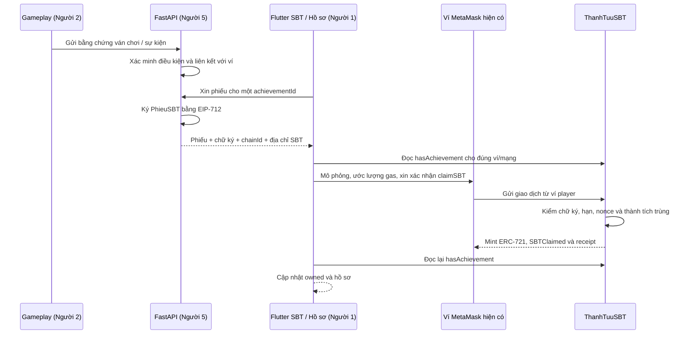

# Tích hợp ThanhTuuSBT — Gold Rush AI Adventure & Blockchain

Tài liệu bàn giao cho nhánh `feature/blockchain`, đối chiếu mã nguồn ngày **05/11/2026**. Những mục ghi **ĐỀ XUẤT / CHƯA TRIỂN KHAI** là giao kèo cần thống nhất giữa các thành viên, không phải endpoint, class hay chức năng đã có. Tài liệu không thực hiện merge vào `dev`.

## 1. Kiến trúc và trách nhiệm



Luồng Gameplay → API cấp phiếu và màn hồ sơ trong sơ đồ là phần tích hợp cần hoàn thiện. Luồng Flutter service → ví → hợp đồng đã có mã và kiểm thử riêng.

| Thành phần | Trách nhiệm |
|---|---|
| Người 2 / Gameplay | Cung cấp bằng chứng hoàn thành màn, trận Boss và thử thách; không tự cấp quyền mint. |
| Người 5 / FastAPI | Xác minh bằng chứng, nhận diện ví, cấp phiếu, quản lý nonce và lưu lựa chọn hồ sơ sau khi kiểm tra chuỗi. |
| Người 1 / Hồ sơ | Dùng model/service hiện có, hiển thị điều kiện và sở hữu riêng biệt, cho người chơi gửi giao dịch và chọn huy hiệu. |
| Module Blockchain | ABI, EIP-712, xác minh quyền sở hữu, gửi giao dịch qua ví hiện có và chống replay. |
| MetaMask | Người chơi xác nhận giao dịch từ ví của mình và trả phí gas bằng ETH của mạng. Không ký phiếu thưởng thay Backend. |

SBT là hợp đồng ERC-721 độc lập. `CuaHangGoldRush` tiếp tục quản lý vàng, nhân vật và đặt cọc theo cơ chế hiện có; SBT không gọi cửa hàng, không đốt vàng và không gộp `claimSBT` vào `multicall` của cửa hàng.

Nguồn mã chính:

- [ThanhTuuSBT.sol](../gold_rush_chain/contracts/ThanhTuuSBT.sol), [test Hardhat](../gold_rush_chain/test/ThanhTuuSBT.ts), [demo local](../gold_rush_chain/scripts/demo_sbt.ts), [module Ignition](../gold_rush_chain/ignition/modules/ThanhTuuSBT.ts).
- [sbt_model.dart](../gold_rush/lib/blockchain/sbt/sbt_model.dart), [sbt_service.dart](../gold_rush/lib/blockchain/sbt/sbt_service.dart).
- [PhienVi](../gold_rush/lib/blockchain/phien_vi.dart), [Vi](../gold_rush/lib/blockchain/vi.dart), [vi_web.dart](../gold_rush/lib/blockchain/vi_web.dart), [BoGiaoDich](../gold_rush/lib/blockchain/giao_dich.dart).

## 2. Giao kèo Solidity, ABI và EIP-712 đang có

### 2.1. Token và danh mục

- ERC-721: name `GoldRush Achievement`, symbol `GRSBT`.
- Constructor: `constructor(address initialOwner, address initialSigner)`. Cả hai địa chỉ phải khác zero; `initialOwner` được kiểm tra bởi OpenZeppelin `Ownable`.
- `achievementId` hợp lệ: **1–5**, theo `MAX_ACHIEVEMENT_ID() == 5`.
- Token ID là số tăng dần toàn hợp đồng, bắt đầu từ 1, **không đồng nhất với achievementId**.
- Mỗi ví nhận tối đa một token cho mỗi achievementId. Nhiều ví có thể có cùng loại thành tích bằng những token khác nhau.

| ID | Tên trong `bangThanhTuuSBT` | Điều kiện dự kiến, do Backend xác minh |
|---|---|---|
| 1 | Thợ Mỏ Tập Sự | Hoàn thành màn 1. |
| 2 | Nhà Thám Hiểm Rừng Xanh | Hoàn thành 6 màn; cần chốt danh sách màn và cách tính với Người 2/5. |
| 3 | Kẻ Săn Boss | Đánh bại Boss đầu tiên. |
| 4 | Chiến Binh Bất Bại | Đánh bại Boss không mất máu; cần chốt phạm vi trận và cách tính sát thương. |
| 5 | Huyền Thoại Gold Rush | Hoàn thành thử thách đặc biệt; cần chốt mã thử thách và phiên bản luật. |

Hợp đồng kiểm tra ID và chữ ký, không kiểm tra người chơi thực sự đã hoàn thành những điều kiện Gameplay này.

### 2.2. Phiếu và domain chính xác

```solidity
struct PhieuSBT {
    address player;
    uint256 achievementId;
    bytes32 nonce;
    uint256 deadline;
}
```

Chuỗi typehash, phải khớp từng ký tự và thứ tự:

```text
PhieuSBT(address player,uint256 achievementId,bytes32 nonce,uint256 deadline)
```

```text
PHIEU_SBT_TYPEHASH =
0x077c00b8deda7e1f1b254c408b884b55ac55baf4a26abc2c690095ac87dc7d7d
```

| Domain field | Giá trị |
|---|---|
| `name` | `GoldRushSBT` |
| `version` | `1` — chuỗi |
| `chainId` | Chain ID thực tế từ RPC, trùng cấu hình đã cho phép của Backend. |
| `verifyingContract` | Địa chỉ **ThanhTuuSBT** đã deploy trên mạng đó. |
| `primaryType` | `PhieuSBT` — thuộc typed data, không phải field của domain. |

Kiểu message dùng khi ký, tương tự `TYPES` trong test/demo:

```json
{
  "PhieuSBT": [
    { "name": "player", "type": "address" },
    { "name": "achievementId", "type": "uint256" },
    { "name": "nonce", "type": "bytes32" },
    { "name": "deadline", "type": "uint256" }
  ]
}
```

Các trường của `EIP712Domain` theo thứ tự là `string name`, `string version`, `uint256 chainId`, `address verifyingContract`. Không thêm salt vào domain ký hiện tại. `eip712Domain()` trả `fields = 0x0f`, salt zero và extensions rỗng.

- `deadline`: giây Unix, không phải milliseconds. Solidity chấp nhận khi `block.timestamp <= deadline`.
- `nonce`: đúng 32 byte, JSON `0x` + 64 ký tự hex. Đây là nonce của phiếu, không phải transaction nonce của ví và cũng không phải `maVan` của phiếu vàng.
- Nonce dùng một lần **trên toàn hợp đồng**, không chia theo ví. Backend phải cấp nonce riêng cho mọi phiếu; đổi signer không xóa `usedNonces`.
- Chữ ký hiện tại: 65 byte `r || s || v`, dạng `0x` + 130 ký tự hex; ECDSA yêu cầu `s` thấp và `v` phù hợp 27/28. Không dùng `personal_sign` để ký phiếu.
- Tất cả trường message đều được ký. `chainId` và `verifyingContract` bảo vệ chống replay khác mạng/hợp đồng.
- Backend đối chiếu digest với `hashVoucher(p)` trước khi đưa adapter mới vào sử dụng.

### 2.3. ABI phục vụ tích hợp

ABI JSON đầy đủ nằm trong artifact `gold_rush_chain/artifacts/contracts/ThanhTuuSBT.sol/ThanhTuuSBT.json`, được sinh bởi `npx hardhat compile`. Những mục dưới đây là các chữ ký thật, không thay thế toàn bộ ABI của ERC-721/Ownable kế thừa.

| Hàm Solidity / chữ ký ABI chuẩn | Kết quả | Selector |
|---|---|---|
| `claimSBT((address,uint256,bytes32,uint256),bytes)` | `uint256 tokenId`, nonpayable | `0x9e34f6bd` |
| `hasAchievement(address,uint256)` | `bool`, view | `0xab5eba16` |
| `achievementOfToken(uint256)` | `uint256`, view | `0x47dd089f` |
| `ownerOf(uint256)` | `address`, view, kế thừa ERC-721 | `0x6352211e` |
| `signer()` | `address`, view | `0x238ac933` |
| `MAX_ACHIEVEMENT_ID()` | `uint256`, getter | `0x89502698` |
| `PHIEU_SBT_TYPEHASH()` | `bytes32`, getter | `0xdaf11c98` |
| `eip712Domain()` | `(bytes1,string,string,uint256,address,bytes32,uint256[])`, view | `0x84b0196e` |

Các hàm còn liên quan:

```solidity
function hashVoucher(PhieuSBT calldata p) public view returns (bytes32);
function claimSBT(PhieuSBT calldata p, bytes calldata signature)
    external returns (uint256 tokenId);
function hasAchievement(address player, uint256 achievementId)
    external view returns (bool);
function achievementOfToken(uint256 tokenId) external view returns (uint256);
function setSigner(address newSigner) external; // onlyOwner
```

`usedNonces(bytes32)` trả `bool`. `owner()` lấy owner quản trị; `ownerOf(tokenId)` lấy chủ sở hữu token. `balanceOf(address)` của ERC-721 đếm token, khác `balanceOf(address,uint256)` của cửa hàng ERC-1155.

```solidity
event SBTClaimed(
    address indexed player,
    uint256 indexed tokenId,
    uint256 indexed achievementId,
    bytes32 nonce
);
event SignerUpdated(address indexed previousSigner, address indexed newSigner);
```

Mint cũng phát `Transfer(address(0), player, tokenId)` theo ERC-721. Backend có thể lập chỉ mục từ `SBTClaimed`, khóa dữ liệu theo `(chainId, verifyingContract, player, achievementId)`. Không lấy return value của lời gọi gửi transaction như thể đó là receipt có token ID.

Các custom error riêng: `InvalidSigner()`, `WrongPlayer()`, `VoucherExpired()`, `NonceAlreadyUsed(bytes32)`, `AchievementAlreadyClaimed(address,uint256)`, `InvalidAchievementId(uint256)`, `InvalidSignature()`, `Soulbound()`. Còn có lỗi kế thừa như `ERC721NonexistentToken(uint256)`, `OwnableInvalidOwner(address)` và `OwnableUnauthorizedAccount(address)`.

`transferFrom(address,address,uint256)` và hai biến thể `safeTransferFrom` đều bị chặn qua `_update`. `approve(address,uint256)` và `setApprovalForAll(address,bool)` luôn revert, được khai báo `pure` nên viem đặt vào nhóm `read`. Không có hàm burn công khai; `_update` cũng chặn burn.

Không có `tokenOfOwnerByIndex`, `tokensOfOwner`, hàm chọn huy hiệu hay hệ thống metadata ảnh SBT trong hợp đồng hiện tại. Không giả định `tokenURI` cung cấp ảnh; danh mục hiển thị nằm ở Flutter/Backend.

## 3. Người 5: xác minh và cấp phiếu trên FastAPI

**CHƯA TRIỂN KHAI API SBT trong Backend đang đọc.** `NguonPhieuSBT` là interface Dart đã có, không phải một HTTP client đã gọi được FastAPI. Không đổi `/api/vang/*` thành API SBT hoặc dùng domain phiếu vàng `GoldRush / 2` cho SBT.

Quy trình đề xuất:

1. Xác thực người dùng và liên kết quyền kiểm soát ví `player` với phiên đăng nhập. Địa chỉ trong body không tự chứng minh quyền sở hữu tài khoản; cơ chế liên kết ví cần Người 1/5 thống nhất riêng với phiếu thưởng.
2. Chỉ chấp nhận chain và địa chỉ hợp đồng thuộc cấu hình Backend. Đọc `signer()` và domain từ đúng hợp đồng; địa chỉ khóa ký của Backend phải khớp signer hiện tại.
3. Tra bằng chứng do server lưu, kiểm tra điều kiện theo phiên bản luật đã thống nhất với Người 2. Không tin `eligible`, số lần thắng hoặc trạng thái Boss do client tự khẳng định.
4. Kiểm tra `hasAchievement(player, achievementId)`. Nếu đã nhận, trả trạng thái đã sở hữu, không cấp phiếu để gửi giao dịch dư thừa. Quyết định cuối vẫn do hợp đồng kiểm tra khi giao dịch thực thi.
5. Cấp nonce 32 byte ngẫu nhiên an toàn, duy nhất trong phạm vi hợp đồng; ràng buộc duy nhất trong kho cấp phiếu để xử lý yêu cầu đồng thời. Tính deadline giây Unix đủ cho người chơi xác nhận ví. Mốc 900 giây trong demo chỉ là ví dụ, không phải chính sách Backend đã triển khai.
6. Ký EIP-712 đúng schema; trả phiếu, chữ ký và domain. Chỉ Backend quản lý khóa ký, không gửi khóa cho Flutter và không ghi khóa vào log/tài liệu.
7. Lưu trạng thái **đã cấp phiếu** riêng với **đã mint**. Theo dõi receipt/event và đọc lại `hasAchievement` để xác nhận mint; không dựa duy nhất vào transaction hash do client gửi.
8. Khi request bị gửi lại, áp dụng idempotency theo người dùng/ví, achievement, chain và hợp đồng. Có thể trả phiếu đang còn hạn; cấp lại phải có nonce mới, vẫn kiểm tra trạng thái chuỗi. Không dùng cùng nonce cho hai ví hoặc hai thành tích.
9. Khi signer được đổi bằng `setSigner`, ngừng cấp bằng khóa cũ, cấp lại phiếu cần thiết; nonce đã dùng vẫn bị chặn. Phiếu khóa cũ bị từ chối khi signer hiện tại khác khóa đó. Nếu ủy quyền lại khóa cũ, phiếu chưa dùng và còn hạn có thể hợp lệ trở lại.

Backend hiện có thư viện mật mã trong [core/eth_ky.py](../gold_rush_ai/core/eth_ky.py) phục vụ luồng cũ. Nếu tái sử dụng cho SBT, phải bổ sung schema/domain riêng và test Python ↔ `hashVoucher` ↔ viem; việc đó **chưa được xác nhận bởi các test SBT hiện tại**.

## 4. Đề xuất API và JSON — chưa có endpoint triển khai

Tất cả URL, trường mở rộng ngoài phiếu và HTTP status trong mục này là **ĐỀ XUẤT**. Chưa được `sbt_service.dart` tự động gọi. Chuỗi dạng `<...>` là placeholder; phải thay trước khi parse bằng model hoặc ký. Không phải phiếu/chữ ký dùng được.

### 4.1. Cấu hình công khai

Đề xuất `GET /api/sbt/cau-hinh`:

```json
{
  "chainId": 31337,
  "verifyingContract": "<địa chỉ SBT từ deployment của mạng hiện tại>",
  "signer": "<địa chỉ công khai từ signer()>",
  "domain": { "name": "GoldRushSBT", "version": "1" }
}
```

`31337` minh họa Hardhat local, không dùng mặc định cho testnet. Flutter phải có nguồn cấu hình được tin cậy/kiểm soát; không dùng địa chỉ tùy ý từ một response phiếu để thay cấu hình service.

### 4.2. Xin phiếu

Đề xuất `POST /api/sbt/phieu`, request:

```json
{
  "player": "<ví gắn với phiên người dùng>",
  "achievementId": 1,
  "chainId": 31337,
  "verifyingContract": "<địa chỉ SBT đã cấu hình>",
  "evidenceIds": ["<mã bằng chứng đã được server tiếp nhận>"]
}
```

Response đề xuất khi đã xác minh đủ điều kiện:

```json
{
  "eligible": true,
  "domain": {
    "name": "GoldRushSBT",
    "version": "1",
    "chainId": 31337,
    "verifyingContract": "<địa chỉ SBT đã cấu hình>"
  },
  "phieu": {
    "player": "<ví được nhận>",
    "achievementId": 1,
    "nonce": "<0x + 64 ký tự hex>",
    "deadline": "<giây Unix dạng chuỗi thập phân>"
  },
  "chuKy": "<0x + 130 ký tự hex của chữ ký Backend>"
}
```

`eligible` là kết quả Backend, **không phải owned**. `evidenceIds` và `eligible` không nằm trong struct ký. `PhieuSBT.fromJson` nhận achievementId dạng số nhỏ hoặc chuỗi thập phân; deadline hỗ trợ chuỗi uint256. Quy ước mọi uint256 có thể lớn như `tokenId`, `deadline` dùng chuỗi thập phân khi truyền JSON để tránh mất chính xác trên Web.

Các lỗi HTTP đề xuất cần thống nhất: `401/403` chưa xác thực/sai liên kết ví; `404` chưa có bằng chứng; `409` đã sở hữu; `422` điều kiện hoặc dữ liệu không hợp lệ; `503` cấu hình signer/RPC chưa sẵn sàng. Adapter chuyển thành `LoiVi` phù hợp; đây chưa phải hành vi của HTTP client SBT hiện có.

### 4.3. Lưu lựa chọn hồ sơ

Đề xuất `PUT /api/sbt/trung-bay`, request:

```json
{
  "player": "<ví của hồ sơ đã xác thực>",
  "chainId": 31337,
  "verifyingContract": "<địa chỉ SBT đã cấu hình>",
  "achievementIds": [1, 3, 5]
}
```

Response chỉ sau khi Backend đọc quyền sở hữu và lưu thành công:

```json
{
  "achievementIds": [1, 3, 5],
  "ownershipVerifiedAtBlock": "<block đã kiểm tra>",
  "saved": true
}
```

Đề xuất `GET /api/sbt/ho-so` để đọc lại lựa chọn theo hồ sơ/ví/chain/hợp đồng. API đọc/lưu hồ sơ này **chưa tồn tại** và `DichVuSBT` chưa có phương thức lưu lựa chọn; Người 1/5 cần tích hợp riêng.

## 5. Người 1: gọi model và service thực tế

### 5.1. Cấu hình, phiên ví và nguồn phiếu

Các đoạn Dart sau là mẫu ghép vào lớp tích hợp của Người 1. `phienViHienTai` là instance `PhienVi` của app, `cauHinhSBTDaNap` là `CauHinhSBT` đã nạp từ nguồn cấu hình, `adapterBackend` là đối tượng Người 5/nhóm tích hợp sẽ cung cấp theo interface hiện có. Đây không phải các biến toàn cục đã khai báo sẵn trong repository.

```dart
import 'package:gold_rush/blockchain/sbt/sbt_model.dart';
import 'package:gold_rush/blockchain/sbt/sbt_service.dart';
import 'package:gold_rush/blockchain/vi.dart';

final sbt = DichVuSBT(
  phienVi: phienViHienTai,
  cauHinh: cauHinhSBTDaNap,
  nguonPhieu: adapterBackend, // Có thể bỏ nếu luôn truyền phiếu trực tiếp.
);

if (!sbt.coHoTroVi) {
  // Hiện trạng thái chưa hỗ trợ ví, không hiện giao dịch thành công giả.
}
```

Service lấy ví từ `phienVi.vi` và địa chỉ từ `phienVi.diaChi`, kiểm tra lại tài khoản đang chọn bằng `eth_accounts`. Nó không tự tạo ví và không gọi `ketNoi()` thay ứng dụng. Dùng luồng kết nối `PhienVi.ketNoi()` hiện có; không tự gán `diaChi` từ response Backend trong sản phẩm.

`PhienVi.ketNoi()` hiện còn nạp cấu hình/phiếu vàng và cửa hàng; SBT không thay quy trình đó. Không gán địa chỉ SBT vào `CauHinhChuoi.hopDong` vốn dùng cho cửa hàng.

### 5.2. Các phương thức công khai

| API hiện có | Dùng khi nào |
|---|---|
| `bool get coHoTroVi` | Kiểm tra sự sẵn có của ví; trên nền tảng chưa hỗ trợ sẽ không giả lập giao dịch. |
| `Future<ThanhTuuSBT> taiThanhTuu(ThanhTuuSBT thanhTuu)` | Đọc lại sở hữu một thành tích cho ví hiện tại. |
| `Future<List<ThanhTuuSBT>> taiDanhSach({List<ThanhTuuSBT>? danhSach})` | Đọc danh sách truyền vào hoặc mặc định `bangThanhTuuSBT`. Kết quả là danh sách không sửa trực tiếp được. |
| `Future<ThongTinTokenSBT> docToken(BigInt tokenId)` | Đọc `tokenId`, `achievementId`, `owner` của token ID đã biết. |
| `Future<String> docSigner()` | Đọc signer được ủy quyền. |
| `Future<PhieuSBTDaKy> xinPhieu(int achievementId)` | Xin qua `nguonPhieu`; thiếu adapter thì ném `LoiVi`. |
| `Future<ThanhTuuSBT> nhanThanhTuu(ThanhTuuSBT thanhTuu, {PhieuSBTDaKy? phieu, void Function(ThanhTuuSBT)? khiCapNhat, void Function(String)? khiDaGui})` | Nhận huy hiệu và theo dõi giao dịch. |

Interface để Người 5/nhóm tích hợp viết adapter:

```dart
abstract interface class NguonPhieuSBT {
  Future<PhieuSBTDaKy> xinPhieu({
    required String player,
    required int achievementId,
    required int chainId,
    required String hopDong,
  });
}
```

Đây là chữ ký đã có trong `sbt_service.dart`; khi viết adapter, **implement** interface đã import, không khai báo lại nó. Ngoài bốn đối số đó, adapter có thể giữ session xác thực và tham chiếu bằng chứng; interface hiện không nhận `evidenceIds` trực tiếp.

Nếu dùng response đề xuất ở mục 4, adapter kiểm tra domain rồi ánh xạ như sau, với `response` là Map đã decode từ API và `cauHinhSBTDaNap` là cấu hình đã tin cậy:

```dart
final domain = Map<String, dynamic>.from(response['domain'] as Map);
if (domain['name'] != 'GoldRushSBT' ||
    domain['version'] != '1' ||
    domain['chainId'] != cauHinhSBTDaNap.chainId ||
    (domain['verifyingContract'] as String).toLowerCase() !=
        cauHinhSBTDaNap.hopDong.toLowerCase()) {
  throw const LoiVi('Domain phiếu SBT không khớp cấu hình ứng dụng.');
}
final phieuDaKy = PhieuSBTDaKy(
  phieu: PhieuSBT.fromJson(
    Map<String, dynamic>.from(response['phieu'] as Map),
  ),
  chuKy: response['chuKy'] as String,
  cauHinh: cauHinhSBTDaNap,
);
```

Adapter cần chuyển dữ liệu sai dạng thành `LoiVi` cho UI. `PhieuSBTDaKy` không có factory `fromJson`; không gọi một factory chưa tồn tại. Constructor kiểm tra dạng chữ ký, còn tính hợp lệ mật mã được hợp đồng kiểm tra qua mô phỏng và giao dịch.

### 5.3. Tải hồ sơ và nhận huy hiệu

```dart
final danhSach = await sbt.taiDanhSach();
final huyHieu = danhSach.firstWhere((s) => s.achievementId == 1);

try {
  final daNhan = await sbt.nhanThanhTuu(
    huyHieu,
    // Không truyền phieu: xin qua adapterBackend đã inject.
    khiCapNhat: (model) {
      // Thay model tương ứng trong state hiện có của màn hồ sơ.
    },
    khiDaGui: (transactionHash) {
      // Lưu mã giao dịch phục vụ theo dõi, không đặt owned = true tại đây.
    },
  );
  // daNhan.owned được service xác minh bằng hasAchievement trên chuỗi.
} on LoiVi catch (loi) {
  // Hiển thị loi.thongBao. loi.nguoiDungTuChoi là thao tác hủy của người chơi.
  // Với LoaiLoiVi.chuaXacNhan: giữ trạng thái chờ, làm mới trước khi gửi lại.
}
```

Nếu đã lấy `phieuDaKy` bên ngoài thì gọi `sbt.nhanThanhTuu(huyHieu, phieu: phieuDaKy, ...)`. Có thể gọi `sbt.xinPhieu(id)` trước, nhưng đó chưa phải một giao dịch mint. Nếu đã sở hữu trên chuỗi, `nhanThanhTuu` trả model thành công mà không xin phiếu và không gửi lại transaction.

### 5.4. Quy tắc trạng thái cho UI

| Model field/getter | Ý nghĩa |
|---|---|
| `eligibilityStatus`, `eligible` | Điều kiện do Backend xác minh; service hiện không tự tính hoặc đổi điều kiện Gameplay. |
| `ownershipStatus`, `owned` | Sở hữu đã đọc từ Blockchain đúng ví/mạng/hợp đồng. |
| `claimStatus` | Tiến độ giao dịch, độc lập với điều kiện và sở hữu. |
| `selectedForDisplay` | Lựa chọn hiển thị từ UI/Backend, chưa chứng minh sở hữu. |
| `displayed` | `owned && selectedForDisplay`. |
| `tokenId` | `BigInt?`; có thể chưa biết dù `owned == true`. |
| `imagePath` | Nullable; danh mục hiện không có ảnh SBT nên đều `null`. |

Các enum thật:

- `TrangThaiDieuKienSBT`: `chuaKiemTra`, `chuaDuDieuKien`, `duDieuKien`.
- `TrangThaiSoHuuSBT`: `chuaKiemTra`, `chuaSoHuu`, `daSoHuu`.
- `TrangThaiNhanSBT`: `chuaBatDau`, `choXacNhanVi`, `dangGui`, `choXacNhanChuoi`, `thanhCong`, `thatBai`, `daHuy`.

Luồng nhận thông thường báo `chuaBatDau → choXacNhanVi → dangGui → choXacNhanChuoi → thanhCong`. `dangGui` được báo sau khi ví trả hash và chuyển ngay sang chờ chuỗi; không giả định mỗi trạng thái có một khoảng thời gian hiển thị riêng. Mặc định service chờ tối đa hai phút, nhịp kiểm tra 1.500 ms.

MetaMask từ chối: `daHuy`. Mô phỏng/receipt thất bại: `thatBai`. Timeout hoặc mất ngữ cảnh sau khi gửi có thể giữ `choXacNhanChuoi`, không đồng nghĩa transaction thất bại. Giao dịch tăng tốc được `BoGiaoDich` nhận ra qua trạng thái đích trên chuỗi.

Khi tải hồ sơ, sai chain gây lỗi và không tự xin chuyển mạng. Khi nhận SBT, service dùng `BoGiaoDich.damBaoMang()` để đề nghị chuyển rồi kiểm tra lại. Nó kiểm tra bytecode, typehash, MAX ID và domain, không chỉ kiểm tra địa chỉ có mã.

`taiThanhTuu`/`taiDanhSach` bỏ token ID cache, vì `hasAchievement` không trả token ID. `BienLai` hiện không chứa logs. Muốn hiển thị token ID, lấy từ chỉ mục `SBTClaimed` của Backend rồi dùng `docToken` kiểm tra owner và achievement tương ứng. Không suy ra token ID từ vị trí danh mục.

`ThanhTuuSBT.fromJson()` luôn trả quyền sở hữu về `chuaKiemTra`, kể cả JSON ghi `owned: true`; `toJson()` ghi tokenId thành chuỗi thập phân. Có `copyWith`, `clearTokenId` và `clearImagePath`. Không dùng `copyWith(ownershipStatus: daSoHuu)` chỉ vì API báo đủ điều kiện hoặc đã có hash.

UI cần nghe phiên ví/sự kiện ví hiện có, bỏ kết quả cũ và tải lại khi đổi tài khoản/mạng. Không dùng model của ví trước để trưng bày cho ví mới. Callback UI phải xử lý vòng đời widget, không ném lỗi khi màn hình đã đóng. Service dùng khóa `phienVi.dangXuLy` và tôn trọng `dangHoi`; không bọc lời gọi SBT bằng một lớp tự đặt `dangXuLy = true` trước đó.

## 6. Tối đa ba huy hiệu trên hồ sơ

Đây là quy tắc UI/Backend **cần triển khai**, không có giao dịch chọn huy hiệu trong `ThanhTuuSBT` và không có giới hạn sở hữu ba token.

1. Người 1 cho chọn từ 0 đến 3 achievementId khác nhau trong các huy hiệu đã xác minh `owned`.
2. Gửi danh sách ID và ngữ cảnh chain/hợp đồng đến API hồ sơ đã thống nhất với Người 5. Không gửi `owned: true` làm bằng chứng.
3. Backend xác thực quyền sửa hồ sơ, liên kết ví, kiểm tra ID trong 1–5, loại bỏ hoặc từ chối phần tử trùng, từ chối hơn ba ID.
4. Backend tự gọi `hasAchievement(player, id)` trên RPC và deployment được tin cậy cho **từng ID**. RPC lỗi/chưa xác nhận được thì không công nhận lựa chọn đó là hợp lệ.
5. Lưu lựa chọn theo hồ sơ + ví + chain + hợp đồng; giữ thứ tự người chơi chọn nếu UI cần. Trả block đã xác minh để hỗ trợ truy vết.
6. Khi tải lại, UI kết hợp lựa chọn từ Backend với kết quả mới của `taiDanhSach`. `selectedForDisplay = true` không tự làm `displayed = true` nếu chưa xác minh sở hữu.

Model không đếm tổng số được chọn trên cả danh sách. Người 1/5 phải áp dụng giới hạn ba ở lớp quản lý danh sách và API; không sửa hợp đồng để xử lý việc trưng bày.

## 7. Người 2: bằng chứng Gameplay cần cung cấp

Nguồn hiện có: [NhatKyChoi](../gold_rush/lib/ai/nhat_ky_choi.dart), [GuiNhatKy](../gold_rush/lib/ai/gui_nhat_ky.dart), [NhatKyVan phía server](../gold_rush_ai/core/nhat_ky.py).

Hiện `NhatKyChoi.thanhJson(...)` gửi các trường như `ma_van`, `man`, `ket_qua` (`thang`, `thua`, `bo`), `phien_ban_app`, `ban_do`, `giay`, `diem`, `anh_chup`, `su_kien` tới `POST /api/nhat-ky`. `ghiNhatXu` và `ghiTrungDon` ghi sự kiện; schema server hiện chỉ cho `nhat_xu`, `trung_don`, `ket_thuc`. **Chưa có sự kiện Boss hoặc phương thức ghi thành tích SBT.**

Không gửi ngay một loại sự kiện Boss mới vào schema cũ rồi coi đã được hỗ trợ. Người 2/5 cần thống nhất extension có phiên bản hoặc luồng bằng chứng riêng trước khi thay mã. Không đổi thứ tự/ý nghĩa vector AI hiện tại khi thêm dữ liệu SBT.

| Thành tích | Bằng chứng cần thống nhất |
|---|---|
| Màn 1 | Mã ván, màn 1, kết quả hoàn thành được server kiểm định, phiên bản luật/màn, liên kết với ví. |
| Hoàn thành 6 màn | Sáu màn hợp lệ khác nhau đã được server xác nhận; không đếm sáu lần thắng cùng một màn nếu luật yêu cầu sáu màn riêng. |
| Boss đầu tiên | ID Boss, ID trận, thời điểm bắt đầu/kết thúc và kết quả đánh bại được xác minh. |
| Boss không mất máu | Bằng chứng Boss như trên, tổng sát thương nhận trong phạm vi trận; không chỉ so máu đầu/cuối vì có thể hồi máu. |
| Thử thách đặc biệt | Mã thử thách, phiên bản điều kiện và bằng chứng hoàn thành tương ứng. |

Các tên `bossId`, `encounterId`, `damageTaken`, `ruleVersion` dưới đây chỉ là **trường đề xuất**, chưa phải field của `NhatKyVan`:

```json
{
  "eventId": "<mã sự kiện duy nhất>",
  "ma_van": "<mã ván đã đăng ký/ghi nhận>",
  "man": 3,
  "kind": "boss_defeated",
  "bossId": "<mã Boss>",
  "encounterId": "<mã trận>",
  "damageTaken": 0,
  "ruleVersion": "<phiên bản luật>",
  "player": "<ví đã liên kết với phiên>"
}
```

Sự kiện client chỉ là đầu vào để Backend đối chiếu. Với các ván luyện tập chưa liên kết ví, phải thống nhất cách liên kết bằng chứng trước khi cấp SBT; `ma_van`/tên hiển thị đơn lẻ không chứng minh người gửi sở hữu ví. Chống gửi lặp bằng ID và liên kết ván đã kiểm định.

Không suy ra “không mất máu” chỉ vì không thấy `trung_don`: danh sách sự kiện hiện có giới hạn 500 mục, ảnh chụp cũng không bao phủ mọi thời điểm. Cần bộ đếm/bằng chứng sát thương đầy đủ và cách kiểm định phía server. Nếu mất mạng khi gửi nhật ký, giữ luồng retry hiện có; chưa có bằng chứng trên server thì chưa cấp phiếu, không làm thay đổi kết quả vàng/đặt cọc cũ.

## 8. Cấu hình và chạy Hardhat local

### 8.1. Công cụ và địa chỉ

Repository dùng Hardhat 3.20.0, viem 2.57.7, OpenZeppelin Contracts 5.7.0 theo lockfile; compiler cấu hình 0.8.36. Dùng Node được Hardhat hỗ trợ, tối thiểu 22.13.0; các lần kiểm thử ghi nhận dùng Node 22.23.4. Flutter đã kiểm thử bằng Flutter 3.47.6 / Dart 3.13.5.

`CauHinhSBT` hiện nhận `chainId`, `hopDong`, tùy chọn `tenMang`, `rpcUrl`. Không có địa chỉ contract mặc định và không tự đọc một biến môi trường Flutter. Người 1/5 phải đưa cấu hình đã nạp vào constructor. Ví dụ cách ánh xạ sau khi đã có cấu hình:

```dart
final cauHinhSBTDaNap = CauHinhSBT(
  chainId: chainIdTuCauHinh,
  hopDong: diaChiSBTTuCauHinh,
  tenMang: tenMangTuCauHinh,
  rpcUrl: rpcUrlTuCauHinh,
);
```

Các biến trong ví dụ là đầu vào của lớp tích hợp, chưa có loader được tạo bởi tài liệu. Với local: chainId `31337`, RPC `http://127.0.0.1:8545`. Truyền tên/RPC nếu muốn ví đề nghị thêm mạng chưa có. Không đặt địa chỉ deploy tạm thời vào source ứng dụng.

### 8.2. Node, deploy và demo

Chạy từ thư mục gốc repository. Terminal A:

```bash
cd gold_rush_chain
npm ci
npx hardhat compile
npx hardhat node --hostname 127.0.0.1
```

Terminal B:

```bash
cd gold_rush_chain
npx hardhat ignition deploy ignition/modules/ThanhTuuSBT.ts \
  --network localhost \
  --parameters '{"ThanhTuuSBTModule":{"owner":"0xf39Fd6e51aad88F6F4ce6aB8827279cffFb92266","backendSigner":"0x70997970C51812dc3A010C7d01b50e0d17dc79C8"}}'
```

Đây chỉ là **địa chỉ công khai** của hai tài khoản thử Hardhat #0/#1, không phải địa chỉ contract. Module yêu cầu cả `owner` và `backendSigner`, không có fallback. Với testnet công khai phải thay bằng địa chỉ thực tế do nhóm quản lý; không dùng tài khoản thử cho triển khai công khai. Mạng `sepolia` đã có trong cấu hình và dùng cơ chế keystore hiện có của Hardhat, không cần đưa khóa vào tài liệu/module.

Lấy địa chỉ SBT từ kết quả Ignition của chính node đang chạy rồi chạy:

```bash
SBT_ADDRESS="<địa chỉ SBT vừa deploy>" \
  npx hardhat run scripts/demo_sbt.ts --network localhost
```

`SBT_ADDRESS` là biến script demo thực sự đọc. `SBT_ACHIEVEMENT_ID` tùy chọn từ 1 đến 5, mặc định 1. Script chọn ví thử khớp `signer()` và một ví người chơi từ các tài khoản sau #1. Nếu chạy lại và ví đã có ID đó, chọn ID chưa nhận hoặc deploy hợp đồng mới. Demo chỉ dùng local và không dùng API FastAPI thật.

Khi restart node, deployment/trạng thái local mất: deploy lại và cập nhật cấu hình Backend/Flutter/MetaMask phù hợp; không coi địa chỉ từng in trong lần chạy cũ là bằng chứng deployment còn tồn tại. Phân biệt `--network localhost` với mạng `default` trong process sẽ mất khi lệnh kết thúc.

### 8.3. Chạy test thường và Web

Từ `gold_rush_chain`:

```bash
npx hardhat test test/ThanhTuuSBT.ts
npx hardhat test
```

Từ thư mục gốc mở terminal khác:

```bash
cd gold_rush
flutter pub get
dart format lib/blockchain/sbt test/blockchain/sbt
flutter analyze --no-pub lib/blockchain/sbt test/blockchain/sbt
flutter test --no-pub test/blockchain/sbt/sbt_model_test.dart test/blockchain/sbt/sbt_service_test.dart
flutter test --no-pub test/blockchain
flutter analyze --no-pub
flutter test --no-pub
```

Kiểm thử Chrome với node Hardhat **riêng**, không dùng node có dữ liệu người khác. Terminal A, từ gốc repository:

```bash
cd gold_rush_chain
npx hardhat compile
npx hardhat node --hostname 127.0.0.1 --port 18545
```

Terminal B, từ gốc repository:

```bash
cd gold_rush
flutter pub get
node test/blockchain/sbt/chuan_bi_web.mjs /private/tmp/sbt-web.json
flutter test --no-pub --platform chrome test/blockchain/sbt/sbt_web_test.dart \
  --dart-define-from-file=/private/tmp/sbt-web.json
```

Đường dẫn `/private/tmp` là ví dụ macOS của môi trường đã kiểm thử; có thể đổi sang file tạm phù hợp trên máy chạy. Helper dùng artifact thật, deploy SBT và cửa hàng mới, cấp vàng/nhân vật/vé thử để so trước-sau, ký phiếu bằng ví Hardhat và ghi dữ liệu công khai cho test. Biến `SBT_TEST_RPC` của helper cho phép đổi RPC loopback, mặc định `http://127.0.0.1:18545`; helper yêu cầu Hardhat chain 31337. Mỗi lần muốn chạy lại ca tích hợp sau khi đã mint, tạo fixture mới bằng helper.

`sbt_web_test.dart` chỉ chạy trên browser; ca tích hợp cần `SBT_WEB_FIXTURE` được cung cấp qua file define nói trên. Nếu không có fixture, ca đó được **skip**, không được báo là đã kiểm thử hợp đồng thật. File fixture Web khác với `sbt_abi_mau.json`, vốn dùng chữ ký giả để kiểm tra mã hóa ABI trong unit test.

**Provider EIP-1193 thử nghiệm trong Chrome không phải tiện ích MetaMask thật.** Nó đi qua `taoViMacDinh()` / `vi_web.dart`, nhưng node Hardhat mở khóa tài khoản để gửi giao dịch; từ chối 4001 được mô phỏng. Kết quả này chưa xác nhận popup, cấp quyền, lựa chọn ví EIP-6963 thực tế và thao tác ký/gửi bằng MetaMask extension của người dùng.

## 9. Thứ tự tích hợp và checklist sau khi merge vào `dev`

Nhóm tự review và thực hiện merge theo quy trình chung; tài liệu này không chạy lệnh merge.

Thứ tự đề xuất: thống nhất luật thành tích/bằng chứng và schema → Người 5 triển khai xác minh/cấp phiếu/cấu hình → adapter `NguonPhieuSBT` → Người 1 nối service vào hồ sơ → API lưu lựa chọn → kiểm thử toàn luồng với MetaMask thật. Có thể phát triển UI bằng mock, nhưng không đánh dấu Backend thật hoặc mint thật đã hoạt động chỉ từ mock.

- [ ] Đủ source hợp đồng, module deploy, demo, model/service và toàn bộ test SBT đã vào `dev`; không nhầm các file chưa được commit với nội dung đã merge.
- [ ] Chốt luật ID 2, 4, 5 và schema bằng chứng Boss, liên kết ví, idempotency với Người 2/5.
- [ ] Deploy SBT độc lập; owner, signer, chainId và domain khớp cấu hình ở Backend/Flutter.
- [ ] API SBT thật có xác thực/kiểm định; Python ký phiếu được `hashVoucher` và hợp đồng chấp nhận.
- [ ] API không tin `eligible`/`owned`/Boss flag do client gửi; không cấp phiếu sai ví hoặc sai chain/hợp đồng.
- [ ] Adapter chuyển đúng `phieu`, `chuKy`, domain sang `PhieuSBTDaKy`; không dùng nhầm schema/domain phiếu vàng.
- [ ] Hồ sơ đọc `taiDanhSach`, phân biệt đủ điều kiện/đã sở hữu/đã chọn; ảnh chưa có dùng placeholder UI, không thêm đường dẫn asset giả.
- [ ] Không kết nối ví lần hai; dùng `PhienVi` và kiểm tra khóa giao dịch chung. Đổi ví/mạng phải bỏ dữ liệu hồ sơ cũ.
- [ ] MetaMask thật: kết nối, đồng ý/hủy chuyển mạng, duyệt/hủy claim, thiếu ETH, receipt thành công/thất bại và tăng tốc giao dịch.
- [ ] Phiếu sai signer, hết hạn, sửa từng trường, dùng lại nonce và nhận trùng thành tích đều bị từ chối; UI không đặt owned trước khi đọc chuỗi.
- [ ] Khi timeout, không gửi lại ngay; kiểm tra ví/receipt và làm mới quyền sở hữu.
- [ ] Backend tự xác minh từng huy hiệu được chọn; hơn ba hoặc chọn huy hiệu chưa sở hữu phải bị từ chối; tải lại hồ sơ vẫn giữ đúng thứ tự/lựa chọn.
- [ ] Vàng, mua nhân vật, đặt cọc vào màn, mất cọc/hoàn cọc và phiếu vàng vẫn chạy như trước; không gắn việc nhận SBT vào điều kiện hoàn cọc.
- [ ] `dart format`, analyze riêng SBT, Flutter test, Hardhat test và test Chrome đã chạy trên kết quả merge, có log thực tế.
- [ ] Lỗi analyze toàn dự án được nhóm sở hữu file xử lý trước khi xác nhận build toàn ứng dụng đạt; không bỏ qua lỗi chỉ vì unit test SBT đạt.

## 10. Trạng thái kiểm thử và phụ thuộc chưa hoàn tất

Kết quả dưới đây đã thực thi trong phiên kiểm thử trước khi viết tài liệu, ngày 05/11/2026. Đây không phải cam kết đã chạy lại trên một bản merge `dev` sau này.

| Hạng mục | Kết quả đã ghi nhận | Phạm vi |
|---|---|---|
| Hardhat SBT | 42 test thành công | Deploy, domain/digest, mint, sở hữu, trùng thành tích, chữ ký/phiếu/domain sai, replay, transfer/approval và signer. |
| Hardhat toàn bộ | 61 test thành công | Gồm 42 SBT và 19 cửa hàng/vàng/đặt cọc. |
| Flutter model | 16 test thành công | JSON, BigInt uint256, copyWith, sở hữu cache và trưng bày độc lập. |
| Flutter service | 45 test thành công | Ví/RPC giả, calldata đối chiếu viem, chưa kết nối, sai chain/hợp đồng, từ chối ví, receipt lỗi, timeout, đổi ngữ cảnh và khóa phiên. |
| Flutter nhóm blockchain | 102 test thành công | Gồm 61 SBT và các test ví/cửa hàng/Backend vàng hiện có. |
| Flutter toàn bộ | 148 test thành công | Các test mặc định; test browser chạy riêng. |
| Chrome | 3 test thành công | JS Promise/EIP-1193, JSON uint256 trên Web, giao dịch SBT thật qua Hardhat local; kiểm tra vàng/nhân vật/vé không đổi. |
| `dart format` và analyze riêng SBT | Đạt | Model, service và test liên quan. |
| Analyze toàn dự án | Chưa đạt: 10 vấn đề có sẵn | Có lỗi `TileLayer.tileAt` tại `gold_rush/lib/components/ban_do.dart:101`, hai warning và các lint/info khác. |

Các test hiện có nằm tại [test/blockchain/sbt](../gold_rush/test/blockchain/sbt). Ca Web đã xác nhận số dư vàng 13, một nhân vật và vé màn 2 / số vé 1 / cọc 5 giữ nguyên sau nhận SBT trong môi trường thử nghiệm. Số liệu này là bằng chứng của một lần chạy, không phải dữ liệu để hardcode vào ứng dụng.

| Phần chưa kiểm chứng/hoàn thiện | Cần phối hợp |
|---|---|
| MetaMask extension thật, popup và thao tác người dùng | Người 1 + Blockchain, trên Chrome có MetaMask và cấu hình mạng đúng. |
| API FastAPI SBT, liên kết ví, xác minh Gameplay và ký bằng triển khai Backend thật | Người 5 + Người 2; tiếp đó đối chiếu với Blockchain. |
| Sự kiện Boss, sát thương cả trận, luật sáu màn và thử thách đặc biệt | Người 2 + Người 5 thống nhất và kiểm thử schema/luật. |
| Adapter HTTP implement `NguonPhieuSBT` | Người 5/nhóm tích hợp + Người 1; interface đã có, HTTP implementation chưa có. |
| UI hồ sơ, chọn/lưu/tải tối đa ba huy hiệu, kiểm quyền sửa hồ sơ | Người 1 + Người 5; contract và service không lưu lựa chọn này. |
| Chỉ mục `SBTClaimed` để cung cấp tokenId cho hồ sơ | Người 5; khi sử dụng phải đối chiếu `docToken`/Blockchain. |
| Triển khai và toàn luồng trên testnet công khai | Blockchain + Người 1/5; kết quả local chưa thay thế testnet. |
| Ví mobile | Chưa có implementation ví mobile trong dự án; phải báo không hỗ trợ. |

Tài liệu chỉ bổ sung hướng dẫn tích hợp. Không thay đổi source Gameplay, UI, Backend, hợp đồng vàng/đặt cọc hoặc tự động gộp nhánh.
