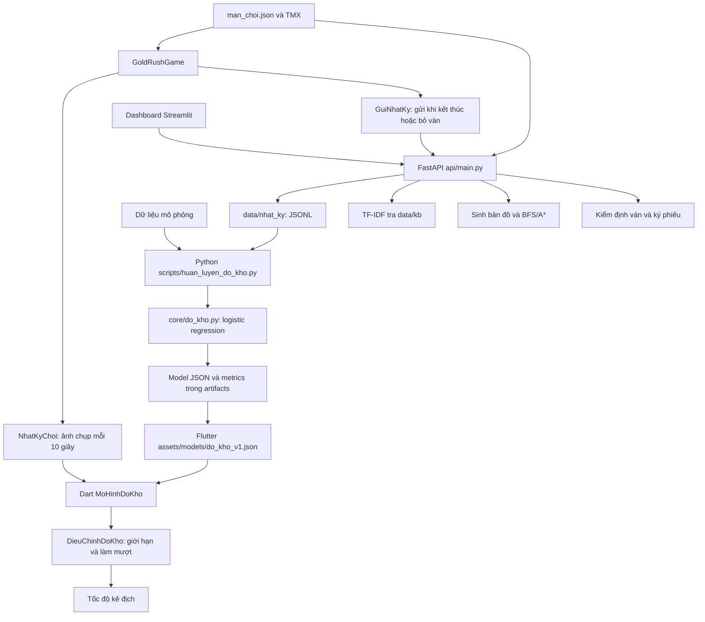

# Báo cáo khảo sát AI Gold Rush NFT

Ngày khảo sát: 05/11/2026. Workspace: `D:\Projects\gold_rush_nft`. Branch: `feature/ai`. Commit đang khảo sát: `a0ef60b`.

**Kết luận:** repository có nền tảng FastAPI, nhật ký ván chơi và độ khó thích ứng bằng hồi quy logistic. Chưa tìm thấy bộ sinh nhiệm vụ, LLM provider, API sinh ảnh hoặc giao diện AI tạo sinh trong source đã khảo sát. Backend mặc định thiếu model độ khó; dùng cấu hình tạm trỏ tới model có sẵn thì 72 test Python đạt. Cả 24 test AI Flutter đạt, nhưng toàn bộ app còn lỗi analyzer ở phần đọc bản đồ. Chưa có bằng chứng chạy trọn game hoặc giao diện Streamlit.

Đây là kết quả **Giai đoạn 0** và kế hoạch đề xuất, chưa phải các tính năng đã được triển khai. Chỉ tạo báo cáo này; không sửa code chức năng, không cài package/model, không commit/push/merge, không giao dịch blockchain hay gọi dịch vụ AI trả phí.

## 1. Phạm vi và tài liệu

Đã đọc yêu cầu trong tệp `Pasted text.txt`, tài liệu `D:\HƯỚNG DẪN NGƯỜI 3.docx`, các README/config/dependency, toàn bộ các module lõi AI, API, dashboard, dữ liệu KB, các script và bộ test Python; khảo sát Flutter AI, HTTP, vòng đời ván, chọn màn, tài nguyên nhân vật và các test AI.

Tài liệu Word là tham khảo phân công, không thay thế yêu cầu mới:

- Yêu cầu mới gồm ba chức năng: nhiệm vụ, cá nhân hóa độ khó, ảnh nhân vật.
- Word hướng tới sprite dùng trong game và điều kiện mở quyền sau sáu màn; yêu cầu hiện tại chỉ cho phép MVP **ảnh tĩnh xem trước**. Chưa đưa điều kiện sáu màn hay nhân vật điều khiển được vào MVP.
- Word đề xuất năm loại nhiệm vụ; chỉ loại nào source gameplay thực tế hỗ trợ mới được bật.
- Theo Word, Người 5 quản lý config/đăng ký router chung. Các thay đổi tại đó trong kế hoạch phải phối hợp, không xem đề xuất trong tài liệu là quyền tự sửa module của người khác.

## 2. Git và trạng thái ban đầu

| Hạng mục | Quan sát |
|---|---|
| Branch hiện tại | `feature/ai`, theo dõi `origin/feature/ai` |
| Thay đổi đã có trước khảo sát | `gold_rush/analysis_options.yaml`: thêm `exclude: build/**` (2 dòng) |
| File chưa được theo dõi đã có trước khảo sát | `gold_rush/pubspec.lock` |
| Staging area | Không có thay đổi được stage |
| Lịch sử local | Một commit `a0ef60b Initial Gold Rush v1.3 source code` |
| Branch/ref local đang biết | `main`, `feature/ai` và các remote-tracking ref `dev`, `feature/gameplay`, `feature/map-backend`, `feature/world-map`, `feature/blockchain` đều trỏ cùng commit |
| Giới hạn | Không fetch; các ref này không chứng minh GitHub hiện tại chưa có thay đổi |

Git theo dõi source, tests, KB, bản đồ, ảnh/âm thanh và `gold_rush/assets/models/do_kho_v1.json`. File lock Flutter hiện chưa được theo dõi dù không bị ignore. Không tìm thấy `AGENTS.md` trong các thư mục được khảo sát hay các thư mục cha của workspace.

Các quy tắc ignore được kiểm chứng bằng `git check-ignore -v`:

- `.venv/`, `venv/`, `__pycache__/`, `*.pyc`, `.env`, `.env.*` được bỏ qua; `.env.example` được phép theo dõi.
- `gold_rush_ai/data/nhat_ky/*.jsonl` được bỏ qua.
- `.dart_tool/`, `build/`, `node_modules/`, `artifacts/`, `cache/` được bỏ qua.
- **Mâu thuẫn:** README và `.gitignore` trong AI nói model JSON nhỏ có thể đưa lên Git, nhưng `.gitignore` gốc bỏ qua mọi `artifacts/`, gồm cả model backend. Không có model tại đường dẫn mặc định trong checkout này.
- Các đường dẫn mặc định `gold_rush_ai/data/phieu/da_cap.jsonl` và `ve_da_bat_dau.jsonl` chưa có quy tắc ignore tương ứng. Chúng thuộc backend trọng tài; cần báo Người 5 trước khi vận hành phần đó.
- Không thấy file `.env`, `.venv`, file khóa cá nhân có đuôi `.pem/.key/.keystore` được Git theo dõi. Các khóa trong test là fixture Hardhat; không dùng làm khóa vận hành. Kiểm tra này không phải kiểm toán bí mật toàn bộ lịch sử Git.

## 3. Kiến trúc đang có



Các đường từ script huấn luyện mô tả luồng đã viết trong source; **không chạy script để tạo model trong lần khảo sát này**. Model backend mặc định đang thiếu, trong khi bản model Flutter đã có.

### Backend và dashboard

FastAPI + Pydantic cung cấp HTTP, Uvicorn phục vụ ứng dụng. `lifespan` nạp model, TF-IDF và danh sách màn vào `STATE`. Module nạp lỗi được ghi log; API liên quan trả 503, server vẫn có thể báo `/api/health` với `status=ok`. Vì vậy cần kiểm tra thêm `da_nap`, không chỉ HTTP 200.

Dashboard Streamlit dùng `requests` gọi API, gồm tổng quan, heatmap, sinh bản đồ, thử model và trợ lý. Các tab đều chạy lại theo cơ chế thực thi script; request có timeout 30 giây. Chưa có tab nhiệm vụ hoặc ảnh AI. Có sử dụng `NamedTemporaryFile(delete=False)` nhưng chưa thấy dọn các file TMX tạm tương ứng.

### Thuật toán và model

| Thành phần | Bản chất thực tế |
|---|---|
| Độ khó | Học máy: hồi quy logistic, 5 đặc trưng; chuẩn hóa theo train, chia nhóm theo ván 70/15/15, chọn C theo validation |
| Bộ điều chỉnh Dart | Luật giới hạn hệ số `[0.8, 1.15]`, mỗi lần đi 30% tới mục tiêu; bắt đầu chỉnh sau 30 giây, ảnh chụp mỗi 10 giây |
| Tìm đường | A* và BFS; thuật toán cổ điển, không phải model học máy |
| Sinh bản đồ | Cellular automata, vùng liên thông, đặt xu theo khoảng cách; PCG, không phải LLM |
| Trợ lý | Hai chỉ mục TF-IDF có dấu/không dấu, cosine; trả nguyên đoạn tài liệu và nguồn, từ chối khi ít liên quan |
| Ảnh nhân vật có sẵn | Script Pillow vẽ/đổi bảng màu; không nhận prompt và không gọi model sinh ảnh |

Model được README mô tả là huấn luyện trên **dữ liệu mô phỏng**. Không có nhật ký thật trong checkout và không có `metrics.json` backend để kiểm chứng chất lượng ngoài thực tế. Không lấy kết quả test mô phỏng làm bằng chứng cải thiện trải nghiệm người chơi.

### API hiện có

OpenAPI được kiểm tra bằng TestClient, xác nhận **15 đường dẫn nghiệp vụ**:

| Method | Endpoint | Chức năng |
|---|---|---|
| GET | `/api/health` | Thành phần bật/nạp và phiên bản model |
| POST | `/api/nhat-ky` | Nhận nhật ký, trả 201; kiểm tra kích thước, schema và mã ván trùng |
| GET | `/api/bang-xep-hang` | Xếp hạng theo ván |
| GET | `/api/thong-ke` | Tổng hợp toàn bộ ván, tách bật/tắt DDA |
| GET | `/api/su-kien` | Lọc sự kiện theo loại và bản đồ |
| POST | `/api/do-kho/du-doan` | Nhận `dac_trung` gồm 5 số, trả `p_thua`, `he_so_toc_do`, phiên bản và tên đặc trưng |
| GET | `/api/mo-hinh/do-kho` | Tải model hiện hành; Flutter hiện chưa gọi để cập nhật model |
| GET | `/api/ban-do/sinh` | Sinh TMX theo seed/mật độ |
| POST | `/api/tro-ly` | Tra cứu hướng dẫn chơi bằng TF-IDF |
| GET | `/api/man` | Danh sách 6 màn; hiện gắn với feature flag `vang` |
| POST | `/api/man/bat-dau` | Đăng ký ván/màn có cọc |
| GET | `/api/man/ve` | Kiểm tra vé đã dùng |
| GET | `/api/vang/cau-hinh` | Cấu hình chuỗi và trọng tài |
| POST | `/api/vang/phieu` | Kiểm định và cấp phiếu ký |
| GET | `/api/vang/cho-nhan` | Các phiếu chờ của ví |

Không có endpoint nhiệm vụ, tạo ảnh, hồ sơ người chơi hay lịch sử hoàn thành nhiệm vụ. Các API hiện tại không có lớp xác thực người dùng chung để module AI có thể tái sử dụng ngay.

### Luồng Flutter và Python

1. Flutter nạp TMX, danh sách màn và model JSON từ assets.
2. Khi chơi, nhật ký giữ số xu, lần trúng đòn, thời gian và các sự kiện có tọa độ. Vector đặc trưng được tính và suy luận ngay trong Dart, không gọi Python mỗi 10 giây.
3. Hệ số AI nhân với `heSoKeDich` của màn. Khoảng `[0.8, 1.15]` là hệ số AI so với nền của màn, không phải trần tốc độ tuyệt đối cho mọi màn.
4. Khi thắng/thua/bỏ ván, Flutter gửi `POST /api/nhat-ky` nếu có `GOLD_RUSH_API`. Timeout 5 giây; tối đa ba lần thử với thời gian chờ 0/2/5 giây. Lỗi không làm crash game.
5. Backend lưu JSONL theo ngày UTC; dashboard và script huấn luyện đọc lại dữ liệu.
6. Luồng xin phiếu vàng dùng `MayChuPhieu`/`PhienVi` riêng; module AI mới phải phối hợp ở ranh giới dữ liệu, không tự cấp thưởng vào chuỗi.

## 4. File quan trọng và khả năng tái sử dụng

Các đường dẫn dưới đây tính từ gốc repository.

| File hoặc nhóm file | Vai trò và cách tái sử dụng |
|---|---|
| `gold_rush_ai/api/main.py` | FastAPI, lifespan, CORS, timing, 15 route; đăng ký router mới có phối hợp Người 5 |
| `gold_rush_ai/config.py` | Cấu hình qua `os.environ`; giữ cách cấu hình này cho provider mới |
| `gold_rush_ai/requirements.txt` | Dependency backend/dashboard/test; chưa khóa phiên bản để tái lập |
| `gold_rush_ai/core/do_kho.py` | Feature contract, mô phỏng, train, suy luận và giới hạn tốc độ |
| `gold_rush_ai/core/nhat_ky.py` | Schema Pydantic, JSONL, thống kê và chuyển nhật ký thành dữ liệu train |
| `gold_rush_ai/core/tro_ly.py` và `data/kb/*.md` | Tra cứu hướng dẫn; tận dụng kiến thức luật chơi, không coi là bộ sinh nhiệm vụ |
| `gold_rush_ai/core/luoi.py` | Đọc TMX, điểm xu, khả năng đi tới; tái dùng cho kiểm tra target nhiệm vụ |
| `gold_rush_ai/core/man_choi.py` | Đọc manifest màn, số xu, giờ; chỉ đọc dữ liệu do module map/backend quản lý |
| `gold_rush_ai/core/sinh_ban_do.py`, `core/ve.py` | PCG và vẽ bản đồ/heatmap; ngoài phần phát triển tính năng AI tạo sinh lần này |
| `gold_rush_ai/core/trong_tai.py`, `core/eth_ky.py` | Kiểm định, sổ vé/phiếu và ký; thuộc ranh giới phối hợp, không sửa cơ chế thưởng |
| `gold_rush_ai/scripts/huan_luyen_do_kho.py` | Train, kiểm tra hơn baseline, xuất model; có thể chép đè asset Flutter nên không chạy tùy tiện |
| `gold_rush_ai/scripts/kiem_tra_ban_do.py` | Kiểm tra bản đồ chỉ đọc; đã chạy |
| `gold_rush_ai/scripts/sinh_ban_do.py`, `sinh_man_choi.py` | Sinh file/bản đồ/manifest; không chạy vì có ghi tài nguyên dùng chung |
| `gold_rush_ai/scripts/sinh_abi_mau.py`, `sinh_phieu_mau.py`, `thu_dau_cuoi.py` | Fixture ABI/phiếu và demo giao dịch Hardhat; đã khảo sát, không chạy |
| `gold_rush_ai/tests/test_api.py`, `test_core.py` | API, model, nhật ký, trợ lý, bản đồ; nền cho test regression |
| `gold_rush_ai/tests/test_api_vang.py`, `test_man_choi.py`, `test_trong_tai.py`, `test_eth_ky.py` | Contract màn và backend trọng tài; giữ nguyên hành vi khi thêm router |
| `gold_rush_ai/streamlit_app.py` | UI demo gọi API; phù hợp thử MVP trước khi ghép giao diện game |
| `gold_rush/lib/ai/nhat_ky_choi.dart`, `gui_nhat_ky.dart` | Telemetry và mẫu timeout/retry; client mới cần model/error riêng |
| `gold_rush/lib/ai/mo_hinh_do_kho.dart`, `dieu_chinh_do_kho.dart` | Suy luận và DDA offline đang có; nên giữ và bổ sung có mục đích |
| `gold_rush/lib/gold_rush_game.dart` | Nơi nối telemetry/DDA và sự kiện gameplay; chỉ thay hook đã thống nhất với chủ module |
| `gold_rush/lib/blockchain/may_chu_phieu.dart` | Mẫu inject `http.Client`, timeout 10 giây và phân tích lỗi; tham khảo, không trộn AI vào service blockchain |
| `gold_rush/lib/man_choi.dart`, `assets/tiles/man_choi.json` | Schema màn dùng chung với Python/chain |
| `gold_rush/lib/tai_nguyen.dart`, `components/nhan_vat.dart` | Nạp/cắt sprite, lớp nền nhân vật; cần khi làm nhân vật chơi được ở phạm vi tương lai |
| `gold_rush/cong-cu/sinh_nhan_vat.py` | Đổi màu George thành ba skin; có thể làm fixture minh họa ghi nhãn demo |
| `gold_rush/test/ai/*.dart`, `assets/models/do_kho_v1.json` | 24 test AI và model kèm vector kiểm tra chéo Python–Dart |

## 5. Mức hoàn thành ba chức năng

| Chức năng | Có gì trong source | Phần còn thiếu | Đánh giá |
|---|---|---|---|
| AI tạo nhiệm vụ | Dữ liệu màn/xu, thời gian, thắng/thua, trúng đòn và trợ lý luật chơi | Schema quest, provider LLM, validator, fallback, lưu nhiệm vụ/lịch sử, API, Flutter client/UI và tests | Chưa có chức năng nhiệm vụ; có nền dữ liệu tái dùng |
| Cá nhân hóa độ khó | Logistic regression; DDA local, làm mượt, giới hạn, tắt được; API dự đoán; pipeline train; tests | Model backend mặc định thiếu; chưa có hồ sơ/lịch sử theo người, score/reason cho đề xuất theo lịch sử; thiếu đánh giá bằng dữ liệu thật và validation đầu vào chặt | Đã có DDA theo trạng thái ván; cần mở rộng để đạt yêu cầu cá nhân hóa theo lịch sử |
| Sinh nhân vật pixel-art từ mô tả | Asset sprite và script vẽ/đổi màu bằng Pillow | Prompt/provider, validation ảnh, API, lưu/dọn ảnh, preview, timeout/quota, demo mode và tests | Chưa có text-to-image; asset hiện tại không phải kết quả model tạo ảnh |

Không có mock nhiệm vụ hoặc mock API sinh ảnh sẵn trong repository. Model độ khó là model thật nhưng dữ liệu huấn luyện được mô tả là mô phỏng. Trợ lý là tra cứu thật, không phải một LLM bị mock.

## 6. Dữ liệu gameplay dùng được và giới hạn

| Dữ liệu hoặc hành động | Hiện trạng |
|---|---|
| Mã ván | Có `ma_van`, ngẫu nhiên mỗi ván; không phải Player ID |
| Stage | Có `man`, tên file TMX, manifest 6 màn |
| Xu | Có `tongXu`, `soXu`, sự kiện `nhat_xu`, `so_xu` trong manifest |
| Điểm | 20 điểm/xu; không đồng nhất với số vàng thưởng trên chuỗi |
| Thời gian | Có thời gian chơi, giờ từng sự kiện, giới hạn màn, kết quả thắng/thua/bỏ |
| Sát thương | Có lần `trung_don` và ảnh chụp tỷ lệ máu; hiện mất cố định 25 máu/lần |
| Tỷ lệ thắng | Tính được cho tập nhật ký; chưa có liên kết tin cậy theo từng người chơi |
| Vàng của ví | Có trong luồng blockchain khi kết nối; không nằm trong schema telemetry AI |
| Level, EXP, lịch sử quest | Chưa có trong model/schema đã khảo sát |
| Màn đã mở khóa/hoàn thành theo người | Chưa có nguồn tiến trình tin cậy trong checkout này; danh sách màn có cọc không tương đương màn đã mở khóa |
| Tiêu diệt zombie/skeleton | Kẻ địch tự nổ khi chạm George và gây sát thương; không có cơ chế tấn công hoặc event đếm kill độc lập |
| Boss, lối thoát bản đồ | Chưa có thành phần/sự kiện tương ứng trong gameplay khảo sát |

MVP nhiệm vụ nên bắt đầu với `collect_coins`, `finish_before_time` và `finish_with_max_hits` (có thể đặt 0 để biểu diễn không nhận sát thương). Cần ghép hook theo dõi nhiệm vụ với chủ gameplay; hiện có dữ liệu nền chứ chưa có bộ đánh giá hoàn thành quest. Không phát nhiệm vụ tiêu diệt 5 zombie: với cơ chế đang có, mỗi va chạm mất 25 máu và lần thứ tư đã thua.

Mỗi màn hiện có 18–24 xu, nên ví dụ “thu 30 vàng” không được chuyển thẳng thành “nhặt 30 xu trong một màn”. Mục tiêu thời gian phải được kiểm tra cùng bản đồ và nhịp chơi; không dùng số ví dụ trong tài liệu làm giá trị mặc định.

Sprite hiện tại đã kiểm tra: `george.png` là RGBA 64×64, gồm 4 hàng hướng xuống/trái/phải/lên, mỗi hàng 4 frame 16×16. Ảnh tĩnh sinh bởi AI không tự trở thành sprite đó. MVP sẽ chỉ preview; tải sprite động từ URL, chuẩn hóa 16 frame và gắn gameplay là một phạm vi cần duyệt riêng.

## 7. Môi trường và cấu hình

### Công cụ và dependency đã quan sát

- Python thực chạy: **3.12.10**, qua `python.exe`. `py -0p` không liệt kê Python, nên nên dùng `python` hoặc đường dẫn `.venv\Scripts\python.exe`, không dựa vào launcher `py`.
- SDK metadata: Flutter **3.47.5**, Dart **3.13.4**; lệnh Dart trực tiếp cũng xác nhận phiên bản này. Cấu hình package Flutter đã tồn tại trong `.dart_tool`.
- Package Flutter local: Flame 1.38.2, Flame Tiled 3.1.2, Flame Audio 2.12.2, HTTP 1.6.0; dependency gián tiếp `tiled` 0.11.1.
- Python global có FastAPI 0.136.3, Uvicorn 0.48.0, Pydantic 2.13.4, NumPy 2.5.3, scikit-learn 1.9.1, Matplotlib 3.11.2, Streamlit 1.65.0, Requests 2.31.0, HTTPX 0.28.1, Pytest 9.1.1, Pillow 12.3.0.
- Chưa có `.venv` AI. Chưa cài `eth-account`; package này dùng cho script demo blockchain, không cần cho 72 test hiện tại.
- Chưa kiểm chứng Android SDK 36, thiết bị/emulator hoặc GPU/RAM để chạy model ảnh local. Không tải model lớn.
- Chưa có thư mục nền tảng `android/`, `web/`, `windows/`... trong checkout. Tạo chúng là việc chuẩn bị môi trường sau duyệt, không thực hiện trong khảo sát.

Các phiên bản trên là **trạng thái local đã đọc**, không phải khuyến nghị nâng cấp hoặc xác nhận phiên bản mới nhất. Bộ test hiện tại chạy được trên Python 3.12.10; chưa đủ để khẳng định mọi dependency tương lai đều tương thích.

### Biến môi trường hiện có

| Nhóm | Biến |
|---|---|
| Đường dẫn | `APP_ROOT`, `APP_FLUTTER`, `KB_DIR`, `NHAT_KY_DIR`, `MO_HINH_DO_KHO`, `BAN_DO_DIR`, `MAN_CHOI` |
| API | `ENABLED`, `CORS_ORIGINS`, `MAX_NHAT_KY_KB` (mặc định 64) |
| Dashboard | `API_URL` (mặc định `http://localhost:8000`) |
| Flutter | `--dart-define=GOLD_RUSH_API=...` |
| Trọng tài/chain | `TRONG_TAI_KHOA`, `CHAIN_ID`, `HOP_DONG_CUA_HANG`, `SO_PHIEU`, `SO_VE` |

`ENABLED` mặc định: `do_kho,tro_ly,ban_do,nhat_ky,vang`. CORS mặc định cho `localhost:8501`, `localhost:5173`, `localhost:5000`; `127.0.0.1` hoặc port khác cần cấu hình tương ứng. **Chưa có cơ chế tự nạp `.env`** trong source; tạo file `.env` đơn thuần không khiến `os.environ` có giá trị.

Chưa có biến hoặc SDK provider LLM/sinh ảnh. Tên provider, model, key, timeout, quota sẽ được thiết kế sau; không đặt khóa trong Flutter.

## 8. Kiểm chứng thực tế

| Kiểm tra | Kết quả | Giới hạn |
|---|---|---|
| Python AST parse | 28 file Python hợp lệ cú pháp | Không chứng minh mọi nhánh chạy đúng |
| Pytest theo config mặc định | **71 passed, 1 failed**, 17.25 giây | `test_du_doan_do_kho`: nhận 503 thay vì 200 vì thiếu file model |
| Pytest với biến model tạm trỏ tới asset Flutter | **72 passed**, 7.46 giây | Không sửa source hoặc tạo model; config mặc định vẫn chưa được sửa |
| Warning Python | 1 cảnh báo Starlette/TestClient về HTTPX | Ghi nhận để xử lý dependency có kiểm soát ở Giai đoạn 1 |
| Script kiểm tra TMX | **6/6 OK** | Kiểm tra reachability, không phải chơi thử toàn bộ |
| Flutter test AI `test --no-pub test/ai` | **24/24 passed** | Test các lớp AI thuần; không phủ toàn bộ game |
| Flutter analyze `analyze --no-pub` | **1 error, 2 warnings, 7 infos**, exit 1 | Có lỗi chặn biên dịch, chưa sửa |
| Git diff check | Không phát hiện whitespace error | Các thay đổi ban đầu vẫn được giữ |

Lệnh Flutter thông thường ban đầu bị vướng file khóa SDK ngoài workspace. Đã chạy kiểm tra thành công qua `dart.exe` + snapshot Flutter có sẵn với quyền mở khóa phù hợp; không chạy `pub get`, không nâng cấp SDK.

API smoke test chạy **trong tiến trình bằng TestClient**, có lifespan, không mở Uvicorn trên cổng mạng:

- `/api/health`: 200, `do_kho=false`, `tro_ly=true` với config mặc định.
- `/api/man`: 200, sáu màn.
- `/api/thong-ke`: 200, không có ván thật.
- `/api/mo-hinh/do-kho`: 503 vì thiếu model.
- `/api/vang/cau-hinh`: 503 vì chưa cấu hình khóa/địa chỉ; đây là thiếu cấu hình, chưa phải bằng chứng logic blockchain lỗi.
- Khi trỏ model tạm, vector `[0.25,1.5,3,0.25,2]` trả 200, `p_thua=0.978033`, `he_so_toc_do=0.8088`.
- Input không đúng miền như tỷ lệ máu `-1` vẫn được API độ khó chấp nhận 200. Schema hiện chỉ giới hạn số phần tử, chưa giới hạn ý nghĩa từng đặc trưng.
- Kiểm tra trực tiếp `core.do_kho.du_doan` với tỷ lệ máu `1000` gây `OverflowError: math range error`; cần cả validation miền giá trị lẫn công thức sigmoid ổn định.

Test Python dùng `-B`/`PYTHONDONTWRITEBYTECODE` và tắt cache pytest; dữ liệu test được ghi trong thư mục tạm. Test liên quan trọng tài chỉ ký/xác minh fixture trong tiến trình, không gửi giao dịch lên chuỗi.

Chưa chạy UI game, Streamlit trong trình duyệt, Uvicorn qua mạng, Android, test Flutter toàn bộ hoặc demo end-to-end blockchain. Báo cáo không khẳng định các phần này đã chạy thành công.

## 9. Vấn đề cần xử lý theo ưu tiên

| Mức | Vấn đề và bằng chứng | Hướng xử lý đề xuất / chủ phối hợp |
|---|---|---|
| P0 | Backend không có model mặc định, test trả 503 | Trước mắt cấu hình đường dẫn tới model có sẵn; Người 5 thống nhất nguồn model backend và quy tắc đóng gói/ignore |
| P0 | `gold_rush/lib/components/ban_do.dart:101` gọi `TileLayer.tileAt` không tồn tại | Đã đối chiếu class `TileLayer` trong package `tiled` local: có `tileData`, không có `tileAt`; chuyển Người 2/5 sửa phần đọc map và kiểm tra va chạm. Không tự sửa trong nhánh AI |
| P1 | Chưa có nhiệm vụ/LLM/ảnh AI | Tạo module độc lập, API router, tests, demo trước rồi ghép game |
| P1 | Chưa có Player ID/lịch sử/progress tin cậy cho cá nhân hóa | Thống nhất player-context contract với backend; demo dùng dữ liệu gắn nhãn, không coi client tự khai là bằng chứng mở khóa/thưởng |
| P1 | Quest thưởng có thể chạm giới hạn/sổ phiếu backend khác | AI tạo nội dung và đề xuất mục tiêu; chính sách thưởng do backend xác minh/quyết định. Demo ban đầu có thể dùng thưởng 0 |
| P1 | API độ khó nhận giá trị sai miền; hàm suy luận gây OverflowError với tỷ lệ máu 1000 | Bổ sung schema hữu hạn và bounds theo từng đặc trưng, kiểm tra model, tính sigmoid ổn định, tests input bất thường |
| P1 | Source AI hiện gộp cả map/backend/chain trong một file API | Router mới tách file, thống nhất đăng ký với Người 5; không refactor rộng `main.py` |
| P2 | Dependency Python không khóa, chưa có venv, warning TestClient | Thiết lập môi trường riêng và ghi nhận tập phiên bản đã kiểm thử; xử lý warning theo nguyên nhân, không nâng hàng loạt |
| P2 | Quy tắc ignore chưa phủ dữ liệu phiếu và dữ liệu AI tương lai | Phối hợp chủ backend cho dữ liệu phiếu; module AI thêm ignore riêng cho DB/ảnh sinh |
| P2 | File tạm Streamlit chưa được dọn; API đọc toàn bộ JSONL khi tổng hợp/dedup | Lập việc cải thiện phù hợp quy mô demo; không sửa lan sang backend chung trong Giai đoạn 0 |
| P2 | README Flutter còn đoạn cũ “Bản đồ chỉ có một màn”, trong khi source/manifest đã có sáu màn | Cập nhật hướng dẫn theo source và kiểm thử thực tế khi bàn giao |

Các cảnh báo/infos Flutter còn lại gồm unused imports và lint tham số/constructor. Chúng không thay thế lỗi biên dịch `tileAt`; chỉ xử lý file thuộc phạm vi AI hoặc gửi chủ module.

## 10. Phương án và contract đề xuất

Đây là các lựa chọn kỹ thuật đề xuất của lần khảo sát, chưa phải quyết định đã được nhóm phê duyệt.

### Nhiệm vụ

Giữ FastAPI, thêm router `/api/ai/nhiem-vu/tao`. Tách provider khỏi nghiệp vụ. Backend xác định objective, màn, target, thời gian và thưởng hợp lệ; LLM hỗ trợ nội dung/đề xuất trong giới hạn; luôn kiểm tra lại JSON trước khi trả. Fallback dùng cùng schema và validator.

Luồng đề xuất:

```text
Player context đã xác minh hoặc demo ghi nhãn
  → lấy khả năng màn từ manifest/TMX
  → lọc objective và giới hạn
  → LLM provider hoặc rule-based fallback
  → parse schema + kiểm tra khả thi + chính sách thưởng
  → lưu nhiệm vụ / chống lặp
  → JSON cho Flutter
```

Input tối thiểu: `stage_id`, ngữ cảnh ván cần thiết. `player_id`, level và unlocked stages lấy từ contract backend khi có. Không bắt client cung cấp trường gameplay chưa tồn tại; context thiếu có thể tạo nhiệm vụ nhập môn trên màn được xác nhận, không tự mở màn mới. Lịch sử quest thuộc module AI; tiến trình game vẫn thuộc backend của nhóm.

Response đề xuất thống nhất một schema: `id`, `stage_id`, `title`, `description`, `objective`, `target`, `time_limit_seconds`, `difficulty`, `reward`, `status`, `generation_source`, `schema_version`. `generation_source` phân biệt `llm`, `rule_based`, `demo`. Chính sách thưởng sinh sau validator từ phía server; AI không có quyền ký/mint hoặc tự xác nhận hoàn thành.

Chống lặp bằng lịch sử nhiệm vụ theo người/phiên, không chỉ đổi UUID hoặc tiêu đề. Nếu chưa có dịch vụ lưu của nhóm, đề xuất SQLite riêng cho dữ liệu quest qua lớp repository; không dùng nó để thay thế dịch vụ tiến trình. Backend owner quyết định cách lưu chính thức trước tích hợp thật.

### Cá nhân hóa độ khó

Tái dùng logistic hiện có cho trạng thái trong ván. Bổ sung lớp đề xuất theo lịch sử đã xác minh với fallback khi thiếu dữ liệu. Có thể dùng luật dễ giải thích cho phần tổng hợp lịch sử và gọi đúng là **rule-based**; không gọi lớp luật mới là model ML đã train.

Endpoint đề xuất `/api/ai/do-kho/de-xuat`: trả `difficulty`, `performance_score`, `reason`, `adjustments.enemy_speed_multiplier`, `source`, `sample_count`, `schema_version`. `performance_score` là điểm được định nghĩa riêng, không tự gọi `p_thua` là tỷ lệ thành công. Chỉ đề xuất hệ số tốc độ là tham số source hiện hỗ trợ; không thêm `enemy_count_multiplier` nếu gameplay chưa cung cấp hook.

Mặc định đề xuất để duyệt: cold-start trả mức trung tính/hệ số 1.0; hệ số nằm trong `[0.8,1.15]`; mỗi lần đề xuất thay đổi tối đa 0.05 so với khuyến nghị trước. Game và backend cần thống nhất một nơi áp dụng hệ số để tránh nhân hai lần với DDA local. Việc ghi đè DDA/gameplay cần Người 2 duyệt hook.

### Ảnh tĩnh pixel-art

| Phương án | Đánh đổi | Đề xuất |
|---|---|---|
| Model local | Chủ động nhưng cần kiểm tra phần cứng, dung lượng và thời gian cài | Chưa chọn/tải model khi chưa biết khả năng máy |
| API ảnh bên ngoài | Nhẹ cho máy cá nhân, cần key, quota, mạng và kiểm soát chi phí | Tách adapter; chỉ chọn dịch vụ/model và gọi thật sau khi bạn duyệt |
| Demo bằng ảnh fixture/biến thể mẫu | Offline, tái lập; không sinh nội dung mới từ mô tả | Dùng kiểm tra flow/UI, trả `generation_source=demo` rõ ràng |

Endpoint đề xuất `/api/ai/nhan-vat/tao` và endpoint lấy ảnh bằng ID. Response có `image_id`, `status`, `image_url`, `width`, `height`, `generation_source`, `schema_version`. Chỉ cho preview ảnh tĩnh, chưa thêm skin vào `bangNhanVat`, chưa sửa `TaiNguyen` để điều khiển nhân vật.

Giới hạn mô tả, timeout và byte/pixel ảnh phải cấu hình; kiểm tra định dạng thực, giải mã ảnh, chuẩn hóa PNG, tên file server sinh, thư mục lưu riêng và chính sách dọn ảnh. Không trả đường dẫn tuyệt đối của máy chủ cho Flutter. Thời gian provider thực tế sẽ quyết định dùng phản hồi đồng bộ có timeout hay job/polling; giữ trạng thái API đủ rõ để mở rộng.

### Quy tắc HTTP chung cần thống nhất

Giữ JSON có phiên bản; 422 cho dữ liệu sai, 503 khi tính năng/provider chưa cấu hình hoặc không sẵn sàng, 429 cho quota. Phân biệt lỗi provider và fallback thành công qua metadata; không trả HTTP 200 chứa một ảnh/quest sai. Timeout không đồng nghĩa yêu cầu tạo bị hủy ở provider: request tạo cần idempotency để retry không phát sinh nhiều job/chi phí. Có request ID và thông báo lỗi đọc được, không đưa key vào log.

## 11. Kế hoạch triển khai sau khi duyệt

Mỗi giai đoạn kiểm tra `git status`/`git diff` trước và sau, báo kết quả thật và dừng ở điểm bàn giao phù hợp. Không tự commit/push/merge/PR.

| Thứ tự | Công việc | Tiêu chí bàn giao |
|---|---|---|
| GĐ1 — môi trường | Tạo `.venv` AI, cài đúng dependency đã thống nhất; xác định model path; thêm `.env.example` và cách nạp env rõ ràng; ghi baseline; phối hợp lỗi map Flutter | Python API nạp được model, bộ 72 test hiện tại đạt trong venv; hướng dẫn PowerShell dùng được; trạng thái lỗi Flutter được ghi rõ |
| GĐ2a — quest offline | Chốt ba objective khả thi, schema và quyền thưởng; validator, fallback, repository/lịch sử; API router và tests | Gửi context hợp lệ nhận JSON quest khả thi; input thiếu/sai được xử lý; không lặp liên tục và không vượt thưởng; demo offline hoạt động |
| GĐ2b — LLM | Provider interface, cấu hình model/key/timeout, prompt, parse JSON, giới hạn, fallback, test provider giả lập | Một flow gọi provider thật khi có cấu hình được duyệt; lỗi mạng/JSON sai chuyển fallback có nhãn; không cần mạng cho test tự động |
| Điểm chặn | Demo MVP nhiệm vụ và rà contract với gameplay/backend | Chỉ chuyển GĐ3 khi MVP nhiệm vụ đã được kiểm chứng; nếu thiếu key/mạng, ghi rõ mới đạt offline MVP và chưa có bằng chứng LLM thật |
| GĐ3 — độ khó | Giữ DDA hiện có; bổ sung validation, tổng hợp lịch sử, score/reason/fallback; phối hợp nơi áp dụng hệ số | Test người mới/yếu/trung bình/giỏi, hệ số bounds và thay đổi từ từ; JSON có thể dùng cho game; phân biệt ML và luật |
| GĐ4 — ảnh tĩnh | Demo fixture trước; provider được chọn/duyệt, input/prompt/timeout/quota, giải mã/chuẩn hóa/lưu/dọn ảnh, preview | Test mô tả rỗng/dài, ảnh hỏng/quá lớn, timeout/lỗi; demo offline rõ nhãn; ít nhất một ảnh thật được kiểm chứng khi cấu hình dịch vụ |
| GĐ5 — Flutter | Model + client riêng, inject HTTP để test, loading/lỗi/retry hợp lý; UI hook được thống nhất; giữ offline fallback | Hiển thị quest, đề xuất độ khó và preview ảnh; lỗi AI không crash; không có API key trong client |
| GĐ6 — bàn giao | Regression Python/Flutter, API sample, README, dữ liệu demo, danh sách hạn chế và kịch bản bảo vệ | Tái lập từ hướng dẫn; ghi rõ test/build nào đạt; demo online/offline và giải thích kiến trúc bằng chứng thực tế |

Checklist nghiệm thu test GĐ2: input hợp lệ; input thiếu dữ liệu; quest sai schema hoặc bất khả thi; provider timeout/lỗi mạng; provider trả JSON sai; fallback hợp lệ; giới hạn thưởng và việc LLM không quyết định thưởng; chống lặp quest; retry tạo nhiệm vụ không tạo trùng.

### File dự kiến tạo hoặc sửa

| Giai đoạn | Tạo mới dự kiến | Sửa có kiểm soát / phối hợp |
|---|---|---|
| GĐ1 | `gold_rush_ai/.env.example`, hướng dẫn baseline trong `docs/` | `gold_rush_ai/README.md`, `requirements.txt`, `.gitignore`; config/model policy và ignore gốc qua Người 5 |
| GĐ2 | `core/ai_nhiem_vu.py`, `core/kiem_tra_nhiem_vu.py`, `core/kho_nhiem_vu.py`, `core/providers/llm.py`, `api/nhiem_vu.py`; tests quest/validator/API/provider; fixture quest và `docs/api_ai_contract.md` | Đăng ký router/config trong `api/main.py`, `config.py` qua Người 5; dashboard để demo |
| GĐ3 | `core/ca_nhan_hoa_do_kho.py`, `api/do_kho_ai.py`, tests theo nhóm trình độ | Bounds/suy luận ở `core/do_kho.py` và schema API hiện có theo kiểm thử; các file Dart DDA chỉ khi thống nhất hook |
| GĐ4 | `core/ai_nhan_vat.py`, `core/providers/anh.py`, `core/kho_anh.py`, `api/nhan_vat_ai.py`, tests input/ảnh/provider/API, fixture PNG mẫu | Dependency Pillow khai báo trực tiếp khi sử dụng; config/ignore ảnh runtime và dashboard |
| GĐ5 | `gold_rush/lib/ai_tao_sinh/api_ai.dart`, `nhiem_vu_ai.dart`, `do_kho_ai.dart`, `nhan_vat_ai.dart`; tests client/models | `main.dart`, lớp phủ UI và hook `gold_rush_game.dart` chỉ sau phối hợp Người 1/2; tận dụng URL chung, không sửa service blockchain |
| GĐ6 | Kịch bản demo, request JSON và tài liệu bàn giao | README AI/Flutter trong phạm vi liên quan |

Đường dẫn ở các dòng GĐ2–4 tương đối với `gold_rush_ai/`. Tên file là dự kiến, có thể tinh chỉnh theo contract được duyệt. `.venv`, DB, nhật ký, ảnh runtime và key không đưa lên Git. Không dự kiến sửa `gold_rush_chain/`, thuật toán map generator, Boss, chiến đấu hoặc hệ thống tiến trình.

## 12. Phối hợp và rủi ro tích hợp branch

| Bên phụ trách | Cần thống nhất | Ảnh hưởng nếu chưa có |
|---|---|---|
| Nhóm trưởng | Phạm vi ba chức năng; chuẩn objective/schema; tiêu chí demo; ngân sách/provider; ưu tiên MVP ảnh tĩnh | Chỉ triển khai trong phạm vi đã duyệt, chưa gọi dịch vụ trả phí |
| Người 5 — backend/map | Player identity/session đã xác minh, level/progress/unlocked stages; registry router/config; cách lưu quest; reward policy và xác minh completion | Có thể demo bằng context mẫu có nhãn, chưa thể tuyên bố cá nhân hóa và thưởng tin cậy theo tài khoản |
| Người 2 — gameplay | Hook nhận nhiệm vụ, đếm xu/lần trúng/thời gian/kết quả; semantics pause; nơi áp dụng độ khó; lỗi `tileAt` | API có thể demo độc lập, game toàn phần còn bị chặn build |
| Người 1 — UI/world map | Chỗ hiển thị quest, loading/error, đề xuất độ khó, preview ảnh và nguồn dữ liệu màn | Cung cấp model/client trước; không tự thay UI chọn nhân vật/world map |
| Người 4 — blockchain | Nếu sau này quest có thưởng vàng thật: policy, chống nhận trùng và cách xác minh qua backend | AI giữ thưởng demo/metadata, không ký phiếu hoặc mint |

File có nguy cơ xung đột cao: `gold_rush_ai/api/main.py`, `config.py`, `requirements.txt`, `core/nhat_ky.py`, `gold_rush/lib/gold_rush_game.dart`, `man_choi.json` và model asset. Tách router/provider/module AI mới giúp giảm vùng sửa chung; không tránh được việc thống nhất schema và chủ file.

Các remote-tracking ref hiện cùng commit nên chưa đo được xung đột với thay đổi chưa fetch. Trước tích hợp cần xem diff từ nhánh nhóm đã cập nhật, giữ contract/version và kiểm thử tương thích; không tự merge/rebase.

## 13. Cách tái lập kiểm tra và cách chạy dự kiến

**Các lệnh kiểm tra đã dùng**, trong `gold_rush_ai/`:

```powershell
$env:PYTHONDONTWRITEBYTECODE = '1'
python -B -m pytest -q -p no:cacheprovider
# Cấu hình mặc định: 71 đạt, 1 lỗi vì model không tồn tại.

$env:MO_HINH_DO_KHO = (Resolve-Path '..\gold_rush\assets\models\do_kho_v1.json').Path
python -B -m pytest -q -p no:cacheprovider
# Với biến tạm: 72 đạt.

python -B scripts/kiem_tra_ban_do.py ../gold_rush/assets/tiles
# 6 bản đồ OK.
```

Biến trên chỉ áp dụng cho phiên PowerShell đang đặt; không sửa cấu hình mặc định trong repository. Lần khảo sát dùng biến tương đương trong tiến trình con riêng.

**Lệnh chạy dự kiến sau khi bạn duyệt Giai đoạn 1**, chưa được chạy để xác nhận UI trong lần này:

```powershell
# Terminal backend, cwd = gold_rush_ai; dùng Python của venv sau khi tạo.
$env:MO_HINH_DO_KHO = (Resolve-Path '..\gold_rush\assets\models\do_kho_v1.json').Path
python -m uvicorn api.main:app --host 127.0.0.1 --port 8000
# Tài liệu: http://localhost:8000/docs

# Terminal dashboard riêng, cwd = gold_rush_ai.
$env:API_URL = 'http://localhost:8000'
python -m streamlit run streamlit_app.py

# Terminal Flutter, cwd = gold_rush, sau khi đã chuẩn bị nền tảng và sửa lỗi map.
flutter run -d chrome --web-port 5000 --dart-define=GOLD_RUSH_API=http://localhost:8000
flutter test --no-pub test/ai
flutter analyze --no-pub
```

Chrome dùng backend cùng máy; Android Emulator thường dùng `http://10.0.2.2:8000`; Android thật dùng IP LAN của máy chủ. Kết nối từ thiết bị khác cần bind server `0.0.0.0`, cùng mạng và cấu hình firewall/phần nền tảng phù hợp; CORS phải khớp origin bản web. Chưa kiểm thử các kết nối này. Nếu tắt `vang` để demo riêng AI, `/api/man` hiện cũng bị tắt; cần thống nhất cách đọc metadata màn độc lập, không bật blockchain chỉ để có danh sách màn.

## 14. Trạng thái bàn giao Giai đoạn 0

Đã khảo sát, lập sơ đồ, thống kê API/file, đánh giá ba tính năng, chạy baseline và lập kế hoạch triển khai. File duy nhất được tạo cho công việc này là `gold_rush_ai/docs/bao_cao_giai_doan_0.md`. Hai thay đổi ban đầu của người dùng được giữ nguyên; test Flutter chỉ sinh cache/build bị ignore.

**Dừng tại đây, chờ bạn duyệt kế hoạch trước Giai đoạn 1.** Các lựa chọn provider/ngân sách, phần thưởng, nguồn player context và hook gameplay cần được chốt ở giai đoạn tương ứng trước khi triển khai phần phụ thuộc.
